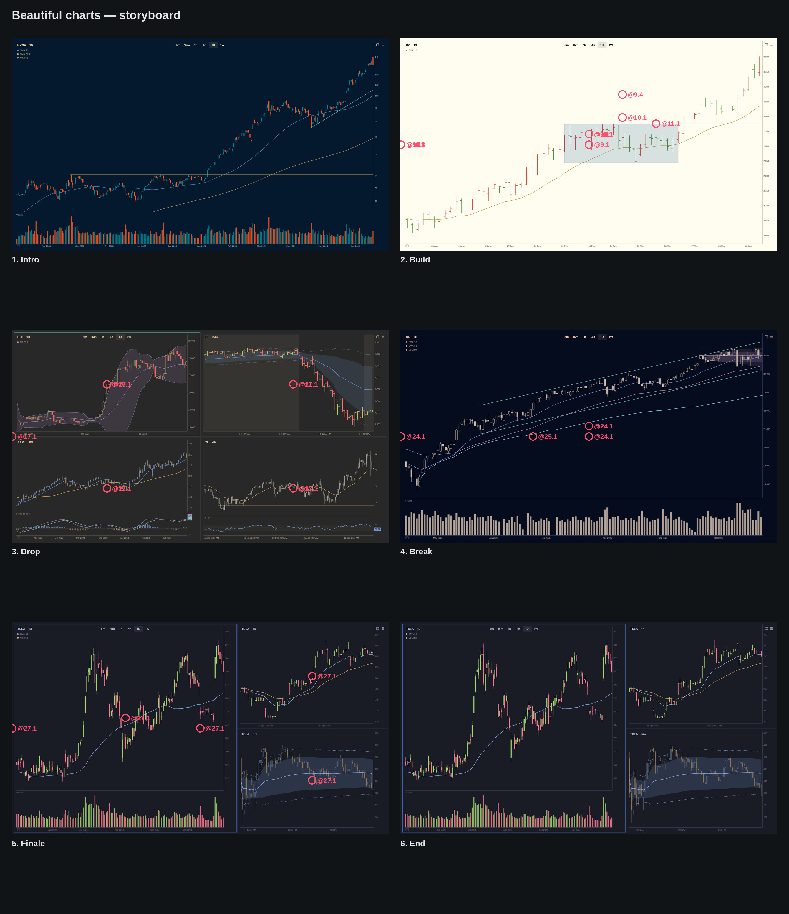

## Brief

**Pitch.** Omacharts charts are beautiful, and they stay beautiful in any
Omarchy theme. A minute of real charts, cut to a beat. This is the second,
bolder cut: something changes every bar in the intro, every half-bar from
bar 11 and every beat on the fill. The build is dark, and the drop opens
white.

**For.** Anyone seeing Omacharts for the first time, Omarchy users above
all. It's a showreel to share, not a tutorial. There's no voice, and no
on-screen text after the cover.

**Payoff.** The cover's fade ends on the downbeat of bar three, on a
close-up of bare NVDA candles in Tokyo Night. The camera pulls back from
2.2× for five bars. One bar in, the whole chart turns light in a single
frame (Catppuccin Latte).

**Beats.** Bars are counted from the track's first downbeat, about two
seconds each.
1. **Intro** (3–8). NVDA, dressed a layer a bar under a slow pull-back.
2. **Build** (9–15). Gold, then SPY, a new look every half-bar, the camera
   snapping in and out.
3. **Fill** (16). SPY splits to two charts, then four, then the bars go,
   under a riser push.
4. **Drop** (17–23). Four markets on white with a flash, a theme a bar, a
   kick on every beat. The camera whips from chart to chart.
5. **Break** (24–25). NQ bare and still for a bar, then dressed all at
   once.
6. **Finale** (26–29). TSLA on three timescales, then a nine-chart wall,
   ending on the bookends Latte and Tokyo Night.
7. **End** (30). Flash and punch into the end card.

**What the source changes.** One chartbook holds the whole video. Each
layout is a chartbook template applied to it, so no tab strip ever
shows. The camera, the kicks and the flashes are drawn afterwards. The
pointer stays hidden and nothing is done on camera by hand: every change,
the reveals of indicators and drawings included, is a command shown
finished on its beat. (A key reveal briefly rings the header's centre.)

## Setup

Seven chartbook templates (Intro, Build, Spy, Drop, Break, Wall, Finale)
are built, and every drawing is placed on its symbol. Gridlines are off
everywhere, and the header shows only symbol and resolution. The sidebar
is hidden first. The Wall's dividers are dragged to thirds, and the
Finale's to sixty percent. Then the Intro look goes on NVDA, bare: no
indicators, no drawings. A custom range leaves a clipped date label at the
right of the time axis, so each range is followed by a wheel nudge over
the chart. A wheel-nudged chart that later loses focus snaps back to the
latest bars, and so do its neighbours, so every cue that changes one chart
of a split sets every chart's window again.

    cli config set show_grid off
    cli config set chart_header symbol,resolution
    key ctrl+shift+b
    cli chart set --template none --symbol NVDA --resolution 1D --style candles --colouring theme --hollow-up off --log-scale on --grid off
    cli chart indicator add sma --period 50 --color Blue
    cli chart indicator add sma --period 200 --color Amber
    cli chart indicator add volume --height 0.15
    cli chartbook template save Intro
    cli chartbook template apply none
    cli chart set --template none --symbol GC --resolution 1D --style candles --colouring theme-mono --hollow-up on --log-scale off --grid off
    cli chart indicator add ema --period 20 --color Amber
    cli chartbook template save Build
    cli chartbook template apply none
    cli chart set --template none --symbol SPY --resolution 1D --style candles --colouring theme --hollow-up off --log-scale off --grid off
    cli chart indicator add sma --period 50 --color Blue
    cli chart indicator add sma --period 200 --color Amber
    cli chartbook template save Spy
    cli chartbook template apply none
    cli chart set --template none --grid off
    cli chart split horizontal
    cli chart split vertical --chart pos:0
    cli chart split vertical --chart pos:2
    cli chart set --chart pos:0 --symbol BTC --resolution 1D --style candles --colouring theme --hollow-up on --grid off
    cli chart indicator add bollinger --chart pos:0 --period 20 --deviations 2 --color Violet
    cli chart set --chart pos:2 --symbol ES --resolution 15m --style ohlc --thickness 3 --colouring theme --session extended --grid off
    cli chart indicator add vwap --chart pos:2 --bands 1,2 --color Blue
    cli chart indicator add session_times --chart pos:2
    cli chart indicator set session_times --chart pos:2 --shade-alpha 0.08
    cli chart set --chart pos:1 --symbol META --resolution 1W --style candles --colouring theme-soft --hollow-up off --log-scale off --grid off
    cli chart indicator add sma --chart pos:1 --period 10 --color Blue
    cli chart indicator add sma --chart pos:1 --period 40 --color Amber
    cli chart indicator add macd --chart pos:1 --height 0.24
    cli chart set --chart pos:3 --symbol CL --resolution 4h --style candles --colouring theme-quiet --hollow-up off --grid off
    cli chart indicator add ema --chart pos:3 --period 20 --color Amber
    cli chart indicator add rsi --chart pos:3 --height 0.2
    cli chartbook template save Drop
    cli chartbook template apply none
    cli chart close --chart pos:3
    cli chart close --chart pos:2
    cli chart close --chart pos:1
    cli chart set --chart pos:0 --template none --symbol NQ --resolution 1D --style candles --colouring theme-mono --hollow-up on --grid off
    cli chart indicator add ema --period 20 --color Blue
    cli chart indicator add ema --period 50 --color Violet
    cli chart indicator add volume
    cli chartbook template save Break
    cli chartbook template apply none
    cli chart set --chart pos:0 --template none --symbol SPY --resolution 1D --style candles --colouring theme --hollow-up off --log-scale off --grid off
    cli chart split horizontal
    cli chart split horizontal --chart pos:1
    cli chart split vertical --chart pos:0
    cli chart split vertical --chart pos:1
    cli chart split vertical --chart pos:3
    cli chart split vertical --chart pos:4
    cli chart split vertical --chart pos:6
    cli chart split vertical --chart pos:7
    drag 50.1% 60% 33.4% 60%
    drag 16% 50.1% 16% 33.4%
    drag 50% 50.1% 50% 33.4%
    drag 84% 50.1% 84% 33.4%
    cli chartbook template save Wall
    cli chartbook template apply none
    cli chart close --chart pos:8
    cli chart close --chart pos:7
    cli chart close --chart pos:6
    cli chart close --chart pos:5
    cli chart close --chart pos:4
    cli chart close --chart pos:3
    cli chart close --chart pos:2
    cli chart close --chart pos:1
    cli chart set --template none --symbol TSLA --resolution 1D --style candles --colouring theme --hollow-up off --indicators on --drawings on --grid off
    cli chart split horizontal
    cli chart split vertical --chart pos:1
    cli chart indicator add sma --chart pos:0 --period 50 --color Blue
    cli chart indicator add volume --chart pos:0
    cli chart set --chart pos:1 --resolution 1h --style ohlc --colouring theme --session regular --grid off
    cli chart indicator add ema --chart pos:1 --period 20 --color Blue
    cli chart indicator add ema --chart pos:1 --period 50 --color Amber
    cli chart set --chart pos:2 --resolution 5m --style candles --colouring theme-soft --hollow-up on --session regular --grid off
    cli chart indicator add vwap --chart pos:2 --bands 1,2 --color Blue
    cli chartbook template save Finale
    cli chart set --chart pos:0 --symbol NVDA --grid off
    cli chart drawing add line --from 2024-04-19,75.61 --to 2024-06-20,105 --color teal --width 2 --chart pos:0
    cli chart drawing add hline --from 2023-08-24,50.55 --to 2024-06-20,50.55 --color amber --chart pos:0
    cli chart set --chart pos:0 --symbol GC --grid off
    cli chart drawing add rect --from 2025-02-10,2974 --to 2025-03-12,2844.1 --config 3 --chart pos:0
    cli chart drawing add hline --from 2025-02-11,2974 --to 2025-04-04,2974 --color amber --chart pos:0
    cli chart set --chart pos:0 --symbol CL --grid off
    cli chart drawing add hline --from 2025-12-16,55.60 --to 2026-01-16,55.60 --color amber --chart pos:0
    cli chart set --chart pos:0 --symbol NQ --grid off
    cli chart drawing add line --from 2025-05-23,20727 --to 2025-10-23,24174 --color teal --width 1.5 --chart pos:0
    cli chart drawing add line --from 2025-05-23,22290 --to 2025-10-23,25737 --color teal --width 1.5 --chart pos:0
    cli chart drawing add hline --from 2025-09-22,25394 --to 2025-10-23,25394 --color amber --chart pos:0
    cli chart drawing add profile --from 2025-09-22,24000 --to 2025-10-23,25400 --config 1 --profile-style filled --align right --transparency 0.55 --poc-color violet --chart pos:0
    cli chart drawing add avwap --from 2025-04-21,17700 --color cyan --bands none --chart pos:0
    cli chart set --chart pos:0 --symbol TSLA --grid off
    drag 50.15% 30% 60% 30%
    move -0.4% 50%
    cli chartbook template apply Intro
    cli chart set --symbol NVDA --style candles --colouring theme --hollow-up off --swap-colours off --log-scale on --indicators off --drawings off --grid off
    cli chart range "2023/07/01..2024/06/20"
    scroll 50% 45% -1
    scroll 50% 45% 1
    move -0.4% 50%
    key Escape

## Script

### 1. Intro

**Picture.** The cover's fade ends on 3.1 on a close-up of NVDA daily candles in Tokyo Night, July 2023 to June 2024, vivid and on a log scale, with nothing else on the chart: the camera starts at 2.2× on the January 2024 breakout and pulls back slowly for twenty-two beats, landing on the full chart at 8.3. On 4.1 the whole window turns light, Catppuccin Latte. On 5.1 the blue fifty-day and amber two-hundred-day averages and a volume strip appear. On 6.1 it goes dark again, Ristretto. On 7.1 the drawings appear: a teal trendline on the lows from the April dip and an amber level at the August 2023 high that the breakout cleared. Bar 8 holds the look, and its last beat is still.

    @3.1: zoom 62% 45% 2.2; drift 50% 50% 1 22
    @4.1: theme catppuccin-latte
    @5.1: early 1.5; cli chart set --indicators on; cli chart focus pos:0; cli chart range "2023/07/01..2024/06/20"; scroll 50% 45% -1; scroll 50% 45% 1; move -0.4% 50%
    @6.1: theme ristretto
    @7.1: early 1.5; cli chart set --drawings on; cli chart focus pos:0; cli chart range "2023/07/01..2024/06/20"; scroll 50% 45% -1; scroll 50% 45% 1; move -0.4% 50%

### 2. Build

**Picture.** On the kick at 9.1 a hard cut to gold (GC) daily, from the end of December 2024 to early April 2025, in Everforest, bare Monochrome candles with hollow rises, the picture punched in a touch and settling. On 10.1 the candles go Soft and an amber twenty-day EMA appears. On 11.1 they go Vivid with a volume strip, and the camera snaps to 1.5× on the February range and the breakout out of it; on 11.3 a soft box round the February range and an amber level along its top appear. On 12.1 the theme flips to Retro 82, and on 12.3 the candles become 3 px OHLC bars. On 13.1 a hard cut to SPY daily, February to mid-July 2025, the tariff crash and the V back, in Gruvbox: vivid candles with the blue fifty-day and amber two-hundred-day averages, the full frame. On 13.3 the camera snaps to 1.4× on the April capitulation. On 14.1 violet Bollinger Bands appear in Lumon; on 14.3 the rises go hollow; on 15.1 the bars become 3 px OHLC in Miasma as the camera snaps back to the full frame; on 15.3 the colour drains to Monochrome.

    @9.1: early 3; theme everforest; punch 0.08; cli chartbook template apply Build; cli chart set --symbol GC --style candles --colouring theme-mono --hollow-up on --swap-colours off --log-scale off --grid off --indicators off --drawings off; cli chart focus pos:0; cli chart range "2024/12/30..2025/04/02"; scroll 50% 45% -1; scroll 50% 45% 1; move -0.4% 50%
    @10.1: early 1.5; cli chart set --colouring theme-soft --indicators on; cli chart focus pos:0; cli chart range "2024/12/30..2025/04/02"; scroll 50% 45% -1; scroll 50% 45% 1; move -0.4% 50%
    @11.1: early 2; zoom 68% 40% 1.5; cli chart set --colouring theme; cli chart indicator add volume --height 0.15; cli chart focus pos:0; cli chart range "2024/12/30..2025/04/02"; scroll 50% 45% -1; scroll 50% 45% 1; move -0.4% 50%
    @11.3: early 1.5; cli chart set --drawings on; cli chart focus pos:0; cli chart range "2024/12/30..2025/04/02"; scroll 50% 45% -1; scroll 50% 45% 1; move -0.4% 50%
    @12.1: theme retro-82
    @12.3: early 1.5; cli chart set --style ohlc --thickness 3; cli chart focus pos:0; cli chart range "2024/12/30..2025/04/02"; scroll 50% 45% -1; scroll 50% 45% 1; move -0.4% 50%
    @13.1: early 3; theme gruvbox; zoom 50% 50% 1; drift 50% 50% 1 1; cli chartbook template apply Spy; cli chart set --symbol SPY --style candles --colouring theme --hollow-up off --swap-colours off --log-scale off --grid off --indicators on --drawings off; cli chart focus pos:0; cli chart range "2025/02/01..2025/07/15"; scroll 50% 45% -1; scroll 50% 45% 1; move -0.4% 50%
    @13.3: zoom 45% 62% 1.4
    @14.1: early 1.5; theme lumon; cli chart indicator add bollinger --period 20 --deviations 2 --color Violet; cli chart focus pos:0; cli chart range "2025/02/01..2025/07/15"; scroll 50% 45% -1; scroll 50% 45% 1; move -0.4% 50%
    @14.3: early 1.5; cli chart set --hollow-up on; cli chart focus pos:0; cli chart range "2025/02/01..2025/07/15"; scroll 50% 45% -1; scroll 50% 45% 1; move -0.4% 50%
    @15.1: early 1.5; theme miasma; zoom 50% 50% 1; cli chart set --style ohlc --thickness 3; cli chart focus pos:0; cli chart range "2025/02/01..2025/07/15"; scroll 50% 45% -1; scroll 50% 45% 1; move -0.4% 50%
    @15.3: early 1.5; cli chart set --colouring theme-mono; cli chart focus pos:0; cli chart range "2025/02/01..2025/07/15"; scroll 50% 45% -1; scroll 50% 45% 1; move -0.4% 50%

### 3. Fill

**Picture.** Under the snare roll a riser push carries the camera from 1.0 to 1.25, slow at first and quickening into the drop. On 16.1 the SPY chart splits in two, SPY beside QQQ over the same months in the same look. On 16.3 it splits again into four, with IWM under SPY and DIA under QQQ. On 16.4 the bars go on all four, leaving only the averages and the bands: the breath before the drop.

    @16.1: early 2; push 50% 50% 1.25 4; cli chart split horizontal --chart pos:0; cli chart set --chart pos:1 --symbol QQQ; cli chart focus pos:1; cli chart range "2025/02/01..2025/07/15"; cli chart focus pos:0; cli chart range "2025/02/01..2025/07/15"; scroll 25% 45% -1; scroll 25% 45% 1; scroll 75% 45% -1; scroll 75% 45% 1; move -0.4% 50%
    @16.3: early 2; cli chart split vertical --chart pos:0; cli chart split vertical --chart pos:2; cli chart set --chart pos:1 --symbol IWM; cli chart set --chart pos:3 --symbol DIA; cli chart focus pos:1; cli chart range "2025/02/01..2025/07/15"; cli chart focus pos:2; cli chart range "2025/02/01..2025/07/15"; cli chart focus pos:3; cli chart range "2025/02/01..2025/07/15"; cli chart focus pos:0; cli chart range "2025/02/01..2025/07/15"; scroll 25% 25% -1; scroll 25% 25% 1; scroll 75% 25% -1; scroll 75% 25% 1; scroll 25% 75% -1; scroll 25% 75% 1; scroll 75% 75% -1; scroll 75% 75% 1; move -0.4% 50%
    @16.4: early 2; cli chart set --chart pos:0 --style none; cli chart set --chart pos:1 --style none; cli chart set --chart pos:2 --style none; cli chart set --chart pos:3 --style none; cli chart focus pos:1; cli chart range "2025/02/01..2025/07/15"; cli chart focus pos:2; cli chart range "2025/02/01..2025/07/15"; cli chart focus pos:3; cli chart range "2025/02/01..2025/07/15"; cli chart focus pos:0; cli chart range "2025/02/01..2025/07/15"; scroll 25% 25% -1; scroll 25% 25% 1; scroll 75% 25% -1; scroll 75% 25% 1; scroll 25% 75% -1; scroll 25% 75% 1; scroll 75% 75% -1; scroll 75% 75% 1; move -0.4% 50%

### 4. Drop

**Picture.** On 17.1, with a flash, a punch from 1.2× and a hard cut out of the push, four markets on White, vivid, and from here a kick on every beat to the end of bar 23: top left, Bitcoin daily from late November 2022 to late February 2023 in hollow candles with violet Bollinger Bands; top right, ES fifteen-minute over the session of 21 September 2026, a rally day, in 3 px OHLC bars with VWAP, its first and second bands and the overnight hours shaded; bottom left, META weekly through 2023 in Soft candles with blue ten-week and amber forty-week averages and a MACD strip; bottom right, crude oil four-hour from mid-December 2025 to mid-January 2026 in Quiet candles with an amber twenty EMA, an amber level at the December low and an RSI strip. On 18.1 the window flips to near-black Hackerman with a punch, and on 18.3 all four go Monochrome. On 19.1 the colour comes back, each chart in its own palette, in Rosé Pine with a punch, and on 19.3 the camera snaps to 2× on Bitcoin. On 20.1, in Kanagawa, it whips right to ES, and on 20.3 the ES bars become candles. On 21.1, in Matte Black, it whips down to crude, and on 21.3 crude turns from Quiet to Vivid. On 22.1, in Jade Horse, it whips left to META, and on 22.3 META turns from Soft to Vivid. On 23.1, in Nord, it snaps back to the full two-by-two, and on 23.3 all four thin out to 1 px OHLC bars.

    @17.1: early 4; theme white; flash 0.35; punch 0.2; zoom 50% 50% 1; drift 50% 50% 1 1; pulses 0.03 28; cli chartbook template apply Drop; cli chart set --chart pos:0 --symbol BTC --style candles --colouring theme --hollow-up on --swap-colours off --log-scale off --grid off --indicators on --drawings on; cli chart set --chart pos:1 --symbol META --style candles --colouring theme-soft --hollow-up off --swap-colours off --log-scale off --grid off --indicators on --drawings on; cli chart set --chart pos:2 --symbol ES --style ohlc --thickness 3 --colouring theme --session extended --swap-colours off --log-scale off --grid off --indicators on --drawings on; cli chart set --chart pos:3 --symbol CL --style candles --colouring theme-quiet --hollow-up off --swap-colours off --log-scale off --grid off --indicators on --drawings on; cli chart focus pos:2; cli chart range "2026/09/21..2026/09/21"; cli chart focus pos:1; cli chart range "2023/01/01..2023/12/31"; cli chart focus pos:3; cli chart range "2025/12/12..2026/01/14"; cli chart focus pos:0; cli chart range "2022/11/25..2023/02/25"; scroll 25% 25% -1; scroll 25% 25% 1; scroll 75% 25% -1; scroll 75% 25% 1; scroll 25% 75% -1; scroll 25% 75% 1; scroll 75% 75% -1; scroll 75% 75% 1; move -0.4% 50%
    @18.1: theme hackerman; punch 0.1
    @18.3: early 2.5; cli chart set --chart pos:0 --colouring theme-mono; cli chart set --chart pos:1 --colouring theme-mono; cli chart set --chart pos:2 --colouring theme-mono; cli chart set --chart pos:3 --colouring theme-mono; cli chart focus pos:2; cli chart range "2026/09/21..2026/09/21"; cli chart focus pos:1; cli chart range "2023/01/01..2023/12/31"; cli chart focus pos:3; cli chart range "2025/12/12..2026/01/14"; cli chart focus pos:0; cli chart range "2022/11/25..2023/02/25"; scroll 25% 25% -1; scroll 25% 25% 1; scroll 75% 25% -1; scroll 75% 25% 1; scroll 25% 75% -1; scroll 25% 75% 1; scroll 75% 75% -1; scroll 75% 75% 1; move -0.4% 50%
    @19.1: early 2.5; theme rose-pine; punch 0.1; cli chart set --chart pos:0 --colouring theme; cli chart set --chart pos:1 --colouring theme-soft; cli chart set --chart pos:2 --colouring theme; cli chart set --chart pos:3 --colouring theme-quiet; cli chart focus pos:2; cli chart range "2026/09/21..2026/09/21"; cli chart focus pos:1; cli chart range "2023/01/01..2023/12/31"; cli chart focus pos:3; cli chart range "2025/12/12..2026/01/14"; cli chart focus pos:0; cli chart range "2022/11/25..2023/02/25"; scroll 25% 25% -1; scroll 25% 25% 1; scroll 75% 25% -1; scroll 75% 25% 1; scroll 25% 75% -1; scroll 25% 75% 1; scroll 75% 75% -1; scroll 75% 75% 1; move -0.4% 50%
    @19.3: zoom 25% 25% 2
    @20.1: theme kanagawa; pan 75% 25% 2
    @20.3: early 2; cli chart set --chart pos:2 --style candles --hollow-up off; cli chart focus pos:0; cli chart range "2022/11/25..2023/02/25"; cli chart focus pos:1; cli chart range "2023/01/01..2023/12/31"; cli chart focus pos:3; cli chart range "2025/12/12..2026/01/14"; cli chart focus pos:2; cli chart range "2026/09/21..2026/09/21"; scroll 25% 25% -1; scroll 25% 25% 1; scroll 75% 25% -1; scroll 75% 25% 1; scroll 25% 75% -1; scroll 25% 75% 1; scroll 75% 75% -1; scroll 75% 75% 1; move -0.4% 50%
    @21.1: theme matte-black; pan 75% 75% 2
    @21.3: early 2; cli chart set --chart pos:3 --colouring theme; cli chart focus pos:0; cli chart range "2022/11/25..2023/02/25"; cli chart focus pos:2; cli chart range "2026/09/21..2026/09/21"; cli chart focus pos:1; cli chart range "2023/01/01..2023/12/31"; cli chart focus pos:3; cli chart range "2025/12/12..2026/01/14"; scroll 25% 25% -1; scroll 25% 25% 1; scroll 75% 25% -1; scroll 75% 25% 1; scroll 25% 75% -1; scroll 25% 75% 1; scroll 75% 75% -1; scroll 75% 75% 1; move -0.4% 50%
    @22.1: theme jade-horse; pan 25% 75% 2
    @22.3: early 2; cli chart set --chart pos:1 --colouring theme; cli chart focus pos:0; cli chart range "2022/11/25..2023/02/25"; cli chart focus pos:2; cli chart range "2026/09/21..2026/09/21"; cli chart focus pos:3; cli chart range "2025/12/12..2026/01/14"; cli chart focus pos:1; cli chart range "2023/01/01..2023/12/31"; scroll 25% 25% -1; scroll 25% 25% 1; scroll 75% 25% -1; scroll 75% 25% 1; scroll 25% 75% -1; scroll 25% 75% 1; scroll 75% 75% -1; scroll 75% 75% 1; move -0.4% 50%
    @23.1: theme nord; zoom 50% 50% 1
    @23.3: early 2.5; cli chart set --chart pos:0 --style ohlc --thickness 1; cli chart set --chart pos:1 --style ohlc --thickness 1; cli chart set --chart pos:2 --style ohlc --thickness 1; cli chart set --chart pos:3 --style ohlc --thickness 1; cli chart focus pos:2; cli chart range "2026/09/21..2026/09/21"; cli chart focus pos:1; cli chart range "2023/01/01..2023/12/31"; cli chart focus pos:3; cli chart range "2025/12/12..2026/01/14"; cli chart focus pos:0; cli chart range "2022/11/25..2023/02/25"; scroll 25% 25% -1; scroll 25% 25% 1; scroll 75% 25% -1; scroll 75% 25% 1; scroll 25% 75% -1; scroll 25% 75% 1; scroll 75% 75% -1; scroll 75% 75% 1; move -0.4% 50%

### 5. Break

**Picture.** On 24.1 a hard cut to Nasdaq futures (NQ) daily, mid-April to late October 2025, in light, airy Lupine: bare Monochrome candles with hollow rises and nothing else, dead still for the whole bar. On 25.1, with a small flash and a punch, it is dressed all at once in Ethereal: the blue twenty and violet fifty EMAs, the volume strip, a teal channel along the advance from May, an amber level at the October high, a volume profile over the last range and a cyan anchored VWAP from the April low. The camera is at 1.3× on the left of the chart and glides right through the bar so the profile comes into frame, a kick on every beat from here to the end.

    @24.1: early 3; theme lupine; cli chartbook template apply Break; cli chart set --symbol NQ --style candles --colouring theme-mono --hollow-up on --swap-colours off --log-scale off --grid off --indicators off --drawings off; cli chart focus pos:0; cli chart range "2025/04/14..2025/10/23"; scroll 50% 45% -1; scroll 50% 45% 1; move -0.4% 50%
    @25.1: early 1.5; theme ethereal; flash 0.12; punch 0.15; zoom 35% 55% 1.3; drift 66% 40% 1.3 4; pulses 0.03 20; cli chart set --indicators on --drawings on; cli chart focus pos:0; cli chart range "2025/04/14..2025/10/23"; scroll 50% 45% -1; scroll 50% 45% 1; move -0.4% 50%

### 6. Finale

**Picture.** On 26.1 a hard cut to TSLA on three charts in Starship, with a punch: on the left, about sixty percent wide, the daily through 2020, the run from about $25 to $240, in vivid candles with a blue fifty-day average and volume; top right the hourly over two weeks of April 2025, the slide to the April low and the rebound, in OHLC bars with blue twenty and amber fifty EMAs; bottom right the five-minute over the latest session in Soft hollow candles with VWAP and its bands. On 27.1, with a punch, a nine-chart wall in Flexoki Light, each the last six months of daily candles, vivid and bare: SPY, QQQ and IWM across the top, AAPL, NVDA and MSFT across the middle, Bitcoin, Ether and Solana across the bottom. On 27.3 the wall goes black, Vantablack. On 28.1 it turns Catppuccin Latte and the camera snaps 3× into NVDA in the centre, and on 28.3 it whips to Solana in the bottom-right corner. On 29.1 it lands back on Tokyo Night, where the video began, the camera cut back to the whole wall and pushing in slowly through the bar.

    @26.1: early 3; theme starship; punch 0.1; zoom 50% 50% 1; drift 50% 50% 1 1; cli chartbook template apply Finale; cli chart set --chart pos:0 --symbol TSLA --style candles --colouring theme --hollow-up off --swap-colours off --log-scale off --grid off --indicators on --drawings on; cli chart set --chart pos:1 --symbol TSLA --style ohlc --thickness 2 --colouring theme --session regular --swap-colours off --log-scale off --grid off --indicators on --drawings on; cli chart set --chart pos:2 --symbol TSLA --style candles --colouring theme-soft --hollow-up on --session regular --swap-colours off --log-scale off --grid off --indicators on --drawings on; cli chart focus pos:1; cli chart range "2025/04/03..2025/04/17"; cli chart focus pos:2; cli chart range "2026/11/06..2026/11/06"; cli chart focus pos:0; cli chart range "2020/01/01..2020/12/31"; scroll 30% 45% -1; scroll 30% 45% 1; scroll 80% 25% -1; scroll 80% 25% 1; scroll 80% 75% -1; scroll 80% 75% 1; move -0.4% 50%
    @27.1: early 4; theme flexoki-light; punch 0.1; cli chartbook template apply Wall; cli chart set --chart pos:0 --symbol SPY --style candles --colouring theme --hollow-up off --swap-colours off --log-scale off --grid off --indicators on --drawings on; cli chart set --chart pos:1 --symbol AAPL --style candles --colouring theme --hollow-up off --swap-colours off --log-scale off --grid off --indicators on --drawings on; cli chart set --chart pos:2 --symbol BTC --style candles --colouring theme --hollow-up off --swap-colours off --log-scale off --grid off --indicators on --drawings on; cli chart set --chart pos:3 --symbol QQQ --style candles --colouring theme --hollow-up off --swap-colours off --log-scale off --grid off --indicators on --drawings on; cli chart set --chart pos:4 --symbol NVDA --style candles --colouring theme --hollow-up off --swap-colours off --log-scale off --grid off --indicators on --drawings on; cli chart set --chart pos:5 --symbol ETH --style candles --colouring theme --hollow-up off --swap-colours off --log-scale off --grid off --indicators on --drawings on; cli chart set --chart pos:6 --symbol IWM --style candles --colouring theme --hollow-up off --swap-colours off --log-scale off --grid off --indicators on --drawings on; cli chart set --chart pos:7 --symbol MSFT --style candles --colouring theme --hollow-up off --swap-colours off --log-scale off --grid off --indicators on --drawings on; cli chart set --chart pos:8 --symbol SOL --style candles --colouring theme --hollow-up off --swap-colours off --log-scale off --grid off --indicators on --drawings on; cli chart focus pos:4; move -0.4% 50%
    @27.3: theme vantablack
    @28.1: theme catppuccin-latte; zoom 50% 50% 3
    @28.3: pan 83.4% 83.4% 3
    @29.1: theme tokyo-night; zoom 50% 50% 1; drift 50% 50% 1.05 4

### 7. End

**Picture.** The last hit at 30.1 lands with a flash and a punch from 1.2× on the wall in Tokyo Night, and resolves into the end card while the music's tail fades.

    @30.1: flash 0.35; punch 0.2

## Pronunciation

None. The video has no narration.

## Storyboard

