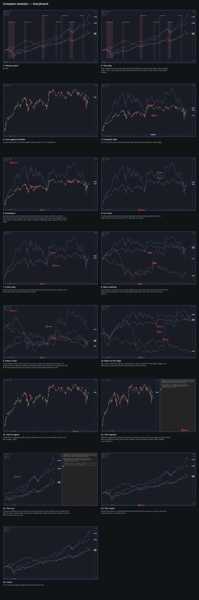

## Brief

**Pitch.** Comparing draws other markets on a chart as lines, all starting
from zero percent at the same bar, so how far each one has come since then
is read straight off the chart. In Omacharts it is a right-click away, and
an agent can build a long-term comparison, annotated, from the terminal.

**For.** Omacharts users who check one market against another by flipping
between charts today, and traders who know comparison charts from other
apps. No prior Omacharts knowledge beyond opening a chart.

**Payoff.** Straight after the cover: SPY on monthly bars over the last
twenty years, since November 2006, with QQQ, GLD and SMH compared on it,
every market a line rising from zero side by side on a log scale, the
price axis in percent. In silence, a third of a second apart, the great
volatility events land on it one after another as shaded bands with bold
labels: the 2008 financial crisis, the 2011 US downgrade, the 2015 China
selloff, the 2018 Fed selloff, the 2020 COVID crash, the 2022 rate hikes,
the 2025 tariffs. No terminal yet; that is saved for the end, where the
agent builds this same chart. Then the first line says the idea in plain
words: start markets from the same day, and the chart shows you which went
further.

**Beats.** Each section opens with a sentence or two over its chart, with
nothing moving, saying what it is about. The first one also carries the
idea that ties the video together.
1. **A first comparison.** On SPY daily, candles: right-click, Compare
   with…, type QQQ in the search and pick it. QQQ's line appears and the
   chart turns to percent. How to read it, one thing at a time: both are
   rebased to zero percent at the same bar, the first one on screen; the
   price axis is in percent; the legend under the header lists each
   market with its change. The pointer moves across the chart and the
   legend reads the bar under it, a dot on each line at that bar; off the
   chart, it reads the last bar again.
2. **Draw it as a line.** Candles against a line read unevenly. Ctrl and
   Shift and S opens Chart settings; Bars, Style, Line: SPY becomes a line
   like QQQ's.
3. **Lines only.** One sentence over the chart menu, opened with a
   right-click, the pointer resting on Lines only: it does the same thing
   just while the chart compares something, and gives the chart its own
   style back when it compares nothing. Escape closes the menu.
4. **More markets.** Right-click, Compare with…, GLD; then again, bitcoin
   (BTC-USD, listed as BTC). Four lines from the same bar, each in the
   next colour of the theme; the legend grows a row for each.
5. **Where it's measured from.** By default the lines start at the first
   bar on screen, so scrolling moves the start. To ask "since that day",
   right-click a bar, Compare from here: a dotted line marks the bar,
   every line passes through zero percent there, and the legend ends with
   a From row naming the day, with a × to undo it. Right-click again,
   Compare from left edge, and a pan shows the base following the screen
   again.
6. **Ask an agent.** A long-term comparison with the history marked on it
   is many small steps, which is what an agent is for. Ctrl and Alt and
   right arrow to a plain SPY daily chart. A terminal opens on the right,
   the agent already at its prompt, and the request is typed in plain
   words: "Compare SPY, QQQ, gold and the semiconductor ETF SMH on a
   long-term monthly chart, and annotate the great volatility events of
   the last twenty years: COVID, the tariffs and the others." The agent
   puts SPY on monthly bars on a log scale, compares QQQ, GLD and SMH from
   November 2006 with every market drawn as a line, shows the whole span,
   and marks seven events with shaded bands and their names; each real
   `omacharts` command lands on the chart as it runs. The terminal closes
   on the annotated chart, held.
7. **Close.** One line: the Comparing markets page of the manual has the
   rest.

**What the source changes.**
- `build: v0.2.21` is tagged and released, with comparing in it.
- Twenty years, not "since 2004": the feed keeps twenty years of daily
  bars, so monthly history starts in November 2006. The payoff, the prompt
  and the agent's chart all say twenty years.
- The payoff is the agent's finished chart, the way the volume profile
  video previews its agent's result: on a chartbook of its own, built in
  Setup, with its seven bands landed by `cli` on the timeline using the
  same commands the agent runs. The storyboard checks the two match.
- Chartbooks, in strip order: Twenty years (the payoff), Compare (SPY
  daily, about six months on screen, for beats 1 to 5) and Long term (SPY daily, a year,
  nothing on it, for the agent). Every band, the payoff's and the
  agent's, is drawn with `--scope local`, so it stays on its own chart and
  never shows on the other SPY charts. A new chartbook opens with its
  sidebar shown, so the agent works on one prepared in Setup rather than
  creating one on camera.
- Beat 3 is said, not clicked: by then the chart is already a line, so
  ticking Lines only would change nothing on screen. The menu is opened,
  the pointer rests on the item, and Escape closes it.
- The × on the From row is named, but the undo is done with Compare from
  left edge, as asked; a pan then shows the lines re-measuring from the
  new first bar.
- The agent: `video/agent/compare-agent`, a played turn that replays the
  choices a real agent with the Omacharts skill made when given this exact
  prompt twice off camera. Its sentences are written; every command it
  shows is the real one, run live. Its own choices, beyond the request:
  monthly bars on a log scale so twenty years fit, the base pinned at
  November 2006 and Lines only on, and the bands' labels at two heights
  so they don't collide. It names the shorter events it left out. The
  studio links every played agent in `video/agent` onto the terminal's
  PATH, so nothing else is needed.
- There is no command that reads a chart's bars, so the bands are drawn
  full height between SPY prices that frame the whole chart, rather than
  around each drawdown. The storyboard checks seven labels stay legible
  at 1080p with the terminal open.
- The search and the legend show bitcoin as BTC; the narration says
  "bitcoin".
- The craft guide allows only cuts and short crossfades. The sweep as the
  terminal opens and closes is the exception, for the agent section
  only, as in the volume profile video.
- The narration quotes no percentages, dates or changes the app shows;
  the storyboard reads them off the studio. Gridlines are off throughout
  (the default for a new chart).
- Length: about 195s, inside the 180 to 200 asked for. 380 words of
  narration, but scenes 12 and 13 are timed by the typing and the agent's
  run, not the voice: about 125 seconds of voice elsewhere, about 22 each
  for those two scenes, and the cover, the silent payoff and the holds
  after each result make up the rest.

## Setup

Three chartbooks, in strip order: Twenty years (the payoff: SPY monthly,
log scale, QQQ, GLD and SMH compared from November 2006, lines only, the
bands added on the timeline), Compare (SPY daily candles, about six months on screen once switched to) and
Long term (the same, for the agent). New charts open on no chart template.
Each chartbook's sidebar is hidden once, after its switch has settled, and
the twenty-year span is set last, on its own chartbook, since a chartbook
switched to comes back on its latest bar.

    cli template default none
    cli chartbook rename "Chartbook 1" "Twenty years"
    cli chart set --symbol SPY --resolution 1M --log-scale on --template none
    cli chart compare add QQQ GLD SMH
    cli chart compare set --from 2006-11-01 --lines-only on
    cli chartbook create Compare --symbol SPY --switch
    cli chart set --template none
    cli chart range 1y --resolution 1D
    cli chartbook create "Long term" --symbol SPY --switch
    cli chart set --template none
    cli chart range 1y --resolution 1D
    wait 1.5
    key ctrl+shift+b
    cli chartbook switch Compare
    wait 1.5
    key ctrl+shift+b
    cli chartbook switch "Twenty years"
    wait 1.5
    key ctrl+shift+b
    cli chart range 2006-11:
    wait 2.0

## Script

### 1. Twenty years

**Picture.** The Twenty years chartbook: SPY on monthly bars since
November 2006, on a log scale, with QQQ, GLD and SMH compared on it, every
market a line in its own colour rising from zero, the price axis in
percent, the legend top left. Held still for about a second. Then, left to
right, a third of a second apart, seven full-height shaded red bands land
with their bold names: 2008 financial crisis, 2011 US downgrade, 2015
China selloff, 2018 Fed selloff, 2020 COVID crash, 2022 rate hikes, 2025
tariffs, the labels at two heights so they don't run into each other.
Held a beat. No voice in this scene. (The bands are `cli`, as a preview of
what the agent draws in scene 13; the storyboard checks they match.)

**Voice.** {bands}

    bands: wait 1.0; cli chart drawing add rect --scope local --from 2007-10-01,60 --to 2009-03-31,2600 --config 2 --alpha 0.12 --border off --text-color ink --font-size 14 --text "**2008 financial crisis**" --text-at top-left; wait 0.35; cli chart drawing add rect --scope local --from 2011-07-01,60 --to 2011-10-31,2600 --config 2 --alpha 0.12 --border off --text-color ink --font-size 14 --text "**2011 US downgrade**" --text-at top-left; wait 0.35; cli chart drawing add rect --scope local --from 2015-08-01,60 --to 2016-02-29,5000 --config 2 --alpha 0.12 --border off --text-color ink --font-size 14 --text "**2015 China selloff**" --text-at top-left; wait 0.35; cli chart drawing add rect --scope local --from 2018-10-01,60 --to 2018-12-31,2600 --config 2 --alpha 0.12 --border off --text-color ink --font-size 14 --text "**2018 Fed selloff**" --text-at top-left; wait 0.35; cli chart drawing add rect --scope local --from 2020-02-01,60 --to 2020-03-31,5000 --config 2 --alpha 0.12 --border off --text-color ink --font-size 14 --text "**2020 COVID crash**" --text-at top-left; wait 0.35; cli chart drawing add rect --scope local --from 2022-01-01,60 --to 2022-10-31,2600 --config 2 --alpha 0.12 --border off --text-color ink --font-size 14 --text "**2022 rate hikes**" --text-at top-left; wait 0.35; cli chart drawing add rect --scope local --from 2025-02-01,60 --to 2025-04-30,5000 --config 2 --alpha 0.12 --border off --text-color ink --font-size 14 --text "**2025 tariffs**" --text-at top-right
    after: 4.0

### 2. The idea

**Picture.** The annotated chart from scene 1, held. Nothing moves.

**Voice.** Start markets from the same day, and the chart shows you which
went further. This is twenty years of SPY, QQQ, gold and SMH, all measured
from the same month, with the big selloffs marked.

    after: 0.6

### 3. One against another

**Picture.** Ctrl and Alt and right arrow, its badge on screen: the
Compare chartbook, SPY on daily candles since May, nothing
compared, the price axis in dollars. Nothing else moves.

**Voice.** {next}It starts with one market against another. Here's SPY on
daily bars.

    next: key ctrl+alt+Right
    after: 0.5

### 4. Compare with

**Picture.** The cursor right-clicks the middle of the chart and the chart
menu opens; a click on **Compare with…** opens the symbol search. "QQQ" is
typed and Enter picks the first result. QQQ's line appears over the
candles in the theme's next colour, the price axis turns to percent, and a
QQQ row joins the legend under the header. The cursor stays where it
clicked, clear of the legend.

**Voice.** It's in the chart's menu. {menu}Compare with, {pick}and the
market you want. {qqq}

    menu: rclick 50% 40%
    pick: click 54.6% 59.8%
    qqq:  type QQQ; key Return
    after: 1.2

### 5. Reading it

**Picture.** The same chart, held through the first two sentences. On
"legend", a zoom of about two times on the legend top left, held while it
is read. Then the zoom eases back and the cursor glides slowly across the
plot, left to right; the legend's rows stay put while their changes follow
the bar under the pointer, and a dot sits on each line at that bar. The
cursor moves off the bottom of the chart and the legend reads the last bar
again.

**Voice.** Both lines start at zero on the same bar, the first one on
screen, and the axis reads percent from there. {legend}The legend lists
each market with its change. {glide}Point at a bar, and it reads that one,
with a dot on each line. {off}Move away, and it's back to the latest.

    legend: zoom 1% 1% 2.2
    glide:  move 25% 55%; wait 0.8; move 50% 45%; wait 0.8; move 72% 50%
    off:    move 40% 99.3%
    after: 1.0

### 6. As a line

**Picture.** The same chart, SPY still on candles under QQQ's line,
held through the first sentence. Ctrl and Shift and S, its badge on
screen, opens Chart settings on its Chart page. A click on the **Bars ›
Style** drop-down, a click on **Line**, and SPY is redrawn as a line in the
theme's text colour. Escape closes the dialog: two lines on the chart.

**Voice.** Candles against a line read unevenly. {settings}In Chart
settings, {style}set the bar style {line}to Line, {close}and SPY is drawn
like the others.

    settings: key ctrl+shift+s
    style:    click 60% 28%
    line:     click 60% 39%
    close:    key Escape; move 40% 99.3%
    after: 1.0

### 7. Lines only

**Picture.** The cursor right-clicks the chart and the chart menu opens;
the cursor glides down to **Lines only** and rests on it, highlighted, not
clicked. Held while it is explained. Escape closes the menu.

**Voice.** {menu}Lines only, in the chart menu, {hover}does the same just
while you compare, and keeps the chart's own style otherwise. {close}

    menu:  rclick 50% 40%
    hover: move 53.6% 64.7%
    close: key Escape; move 40% 99.3%
    after: 0.8

### 8. More markets

**Picture.** The same chart, held through the first sentence. The cursor
right-clicks, **Compare with…**, "GLD" typed, Enter: gold's line joins in
the next colour, a GLD row in the legend. Again: right-click, **Compare
with…**, "BTC", Enter picks Bitcoin: a fourth line, a BTC row in the
legend. The cursor rests off the chart.

**Voice.** Any number of markets fit on one chart. {gld}Here's gold, from
the same menu and the same search. {btc}And bitcoin. Each market
takes the theme's next colour, and a row in the legend.

    gld: rclick 50% 40%; wait 0.4; click 54.6% 59.8%; wait 0.6; type GLD; key Return
    btc: rclick 50% 40%; wait 0.4; click 54.6% 59.8%; wait 0.6; type BTC; key Return; wait 0.4; move 40% 99.3%
    after: 1.2

### 9. Since a day

**Picture.** The four lines, held through the first two sentences. The
cursor right-clicks the late-July dip and the chart menu opens; a click
on **Compare from here**. A dotted line marks that bar, every line
passes through zero percent there, and the legend ends with a new row,
**From** and the day, with its ×. On "names", a zoom of about two times on
the legend, From row included.

**Voice.** So far the lines start at the first bar on screen, so they
move when the chart does. To measure since a day that matters,
{menu}right-click its bar, {here}and Compare from here. Every line passes
through zero there, {zoom}and the legend names the day.

    menu: rclick 45.9% 40%
    here: click 51.2% 62.3%; wait 0.4; move 40% 99.3%
    zoom: zoom 1% 1% 2.2
    after: 1.2

### 10. Back to the edge

**Picture.** The zoom eases back. The cursor right-clicks the chart and
the menu, now with **Compare from left edge** in it; a click on it: the
dotted line and the From row go, and every line starts again at the first
bar on screen. Then the cursor drags the chart a few weeks back in time:
as it pans, every line re-measures from the new first bar. The cursor
rests off the chart.

**Voice.** The cross on that row undoes it, {menu}and so does Compare
from left edge, {edge}in the same menu. {pan}Now the lines start wherever
the chart does.

    menu: rclick 60% 40%
    edge: click 66% 64.7%
    pan:  drag 60% 50% 72% 50%; wait 0.4; move 40% 99.3%
    after: 1.2

### 11. Ask an agent

**Picture.** The Compare chart, held through the voice. Then Ctrl and Alt
and right arrow, its badge on screen: the Long term chartbook, SPY on
daily candles over the last year, nothing compared, nothing drawn.

**Voice.** A long-term comparison, with its history marked on it, is a
lot of small steps. That's work for an agent. {next}

    next: key ctrl+alt+Right; move 75% 99.3%
    after: 1.2

### 12. The request

**Picture.** A terminal opens on the right, taking about 38% of the
width, themed like the app, the composer covering the snap with a light
sweep and labelling the two panes; the chart reflows into the rest. The
agent is already running, at its bare `❯` prompt, nothing typed to start
it. The request is typed at human speed, about twenty-two seconds of it:
"Compare SPY, QQQ, gold and the semiconductor ETF SMH on a long-term
monthly chart, and annotate the great volatility events of the last twenty
years: COVID, the tariffs and the others." Enter sends it. (Typing and
Enter are one cue, so they run in order; `after:` holds the scene until
the typing is done. The storyboard measures it and trims `after:` so the
scene ends just after Enter.)

**Voice.** {open}An agent drives Omacharts from the terminal, with the
same commands you'd type. {ask}Here it's asked for twenty years of four
markets, with the selloffs marked. Which selloffs count is left to it.

    open: terminal open compare-agent --pace 0.8; move 140% 97%
    ask:  type Compare SPY, QQQ, gold and the semiconductor ETF SMH on a long-term monthly chart, and annotate the great volatility events of the last twenty years: COVID, the tariffs and the others.; key Return
    after: 16.5

### 13. The run

**Picture.** The agent's three lines of plan, then its real commands one
by one, each landing on the chart as it prints: SPY goes to monthly bars
on a log scale; QQQ, GLD and SMH appear as lines; the base is pinned at
November 2006 and SPY turns to a line; the chart spans twenty years. A
second note on the plan, the `band` function it defines, and seven `band`
lines, each one a shaded red band with its bold name landing on the
chart, left to right. On "Then", timed to the first band (the 2008
financial crisis), one zoom of about 1.8 times on the top left of the chart
pane, eased back for the rest, which run at their own pace. It ends on its
summary: seven selloffs marked, and the shorter ones it left out. The run
takes about seventeen seconds at this pace; the storyboard measures it and
sets `after:` so the summary is on screen and read before the scene ends.

**Voice.** It goes to monthly bars on a log scale, so twenty years fit,
and measures every market from the first month. {zoom}Then it marks each
selloff with a band and its name. Every command lands on the chart as it
runs.

    zoom: zoom 0% 0% 1.8
    after: 8.5

### 14. The result

**Picture.** The terminal closes, the same light sweep covering it, and
the chart widens back to the full frame: twenty years of SPY, QQQ, GLD and
SMH from the same month, seven bands across them, the same chart as scene
1. Held, the cursor off the chart.

**Voice.** {close}Each band is a selloff the agent picked. Read the lines
across it, and you see which markets held up, and which didn't.

    close: terminal close; focus app; move 40% 99.3%
    after: 2.5

### 15. Close

**Picture.** The annotated twenty-year chart, held. The cursor rests off
the chart.

**Voice.** The Comparing markets page of the manual has the rest.

    after: 2.5

## Pronunciation

- SPY: S P Y
- QQQ: triple Q
- GLD: G L D
- SMH: S M H
- BTC-USD: bitcoin
- Omacharts: Oma-charts

## Storyboard

