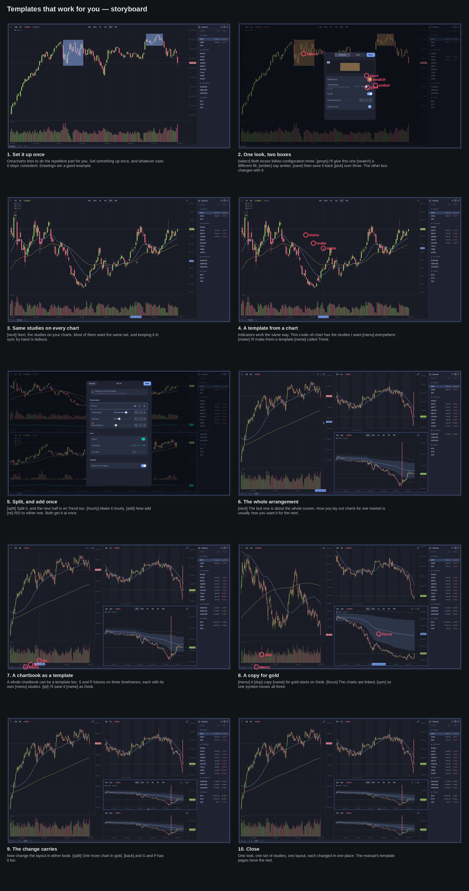

## Brief

**Pitch.** In Omacharts you set a thing up once and everything using it
follows: a drawing's look, a chart's indicators, a whole chartbook's
arrangement. Change it in one place and the rest change with it.

**For.** Traders already charting in Omacharts who still restyle drawings
one by one and rebuild the same layout for every market.

**Payoff.** Right after a short opening on the idea, two boxes on a Nasdaq
futures chart, one gets a new look in its properties, and the moment it's saved
the other box changes with it, untouched.

**Beats.** Each of the three sections opens with a brief introduction,
voiced over the chart it is about to use, saying what that kind of
template keeps consistent; the first one also states the idea behind the
whole video, in plain words.
1. **Drawings.** Two boxes on NQ daily (Alt and R), both on the same
   configuration. Open one's properties (Alt and Enter), give it a new fill
   colour, and Save as… back over its configuration number. The other box
   changes too.
2. **Chart templates.** A crude oil chart already carrying its studies
   (setup): right-click › Template › Create new template from chart…, name
   it. Split it (Ctrl and Alt and V) and turn the new half to hourly; the
   header shows it's on the same template. Add one study to either chart
   (Ctrl and Shift and I) and both get it, before the dialog is even closed.
3. **Chartbook templates.** An ES chartbook, built off camera: daily on the
   left with the fifty- and two-hundred-day averages and volume, hourly top
   right with a twenty-period average and session shading, five-minute
   bottom right with VWAP and its bands. Save it as a chartbook template
   from its tab. Duplicate it, type GC on a chart and all three go to gold.
   Split the five-minute chart in the gold book, switch back (Ctrl and Alt
   and left arrow): the ES book has the same new chart.
4. **Close.** One line on what this saves, and where to read more.

**What the source changes.**
- Beat 2: splitting a chart already puts the new half on the same template
  (the manual: "You split the chart: the new chart is on the same
  template"), so there is no template to select after the split. The beat
  shows that instead, with the header naming the template on both charts.
  If you want the act of choosing seen, a second chart on no template could
  be put on it with Ctrl, Alt, Shift and a number, at the cost of a few
  seconds.
- Beat 3: building three charts with their studies on camera would take most of
  the video, so the chartbook is ready when the beat starts and the
  video shows saving, cloning and the change that carries. Duplicating a
  chartbook keeps its template, so the copy is on it from the start. The
  three ES charts are set to Follow in setup, so one typed GC moves all
  three; otherwise it moves only the chart you're on.
- "Editing the layout" is shown as a split, because a chart appearing in
  both books reads at a glance. Dragging a divider or changing a
  resolution carries the same way and would be quieter on screen.
- Studies are added on camera only once, in beat 2. Creating a template,
  saving a chartbook template and duplicating each ask for a name, which
  means three short typed names. That, plus three reveals that each need a
  second's hold, is why the video ran seventy-five seconds with every beat
  kept; the three introductions add about twenty-five more.
- Drawings show on every chart of their symbol, which is why each beat has
  its own symbol (NQ, CL, then ES and GC): beat 1's boxes stay out of the
  later charts.
- Futures by root: the symbol search finds `ES` (E-mini S&P 500), `GC`
  (Gold), `NQ` and `CL`. On Yahoo, futures are ten minutes delayed, which
  doesn't matter here.
- "Omacharts works for you" is the idea the video is built on. It isn't
  said anywhere in the narration, the close included.

## Setup

Three chartbooks, one per beat, in strip order: Nasdaq (NQ daily, two boxes
on configuration 3), Crude (CL daily with two averages and volume, on no
template) and S&P (three ES charts, all Follow). New charts open on no chart
template, so the studies set here are each chart's own and nothing leaks
into the Default template. The header names the chart template.

    cli config set chart_header symbol,resolution,change,template
    cli template default none
    cli chartbook rename "Chartbook 1" Nasdaq
    cli chart set --symbol NQ --resolution 1D
    cli chart range 6m
    cli chart drawing configure rect --config 3 --alpha 0.5
    cli chart drawing add rect --from 2026-06-05,30970 --to 2026-07-02,28230 --config 3
    cli chart drawing add rect --from 2026-09-22,31620 --to 2026-10-13,30360 --config 3
    cli chartbook create Crude --symbol CL --switch
    cli chart set --resolution 1D
    cli chart indicator add ema --period 20 --color Blue
    cli chart indicator add ema --period 50 --color Amber
    cli chart indicator add volume
    cli chart range 6m
    cli chartbook create "S&P" --symbol ES --switch
    cli chart split horizontal
    cli chart split vertical --chart pos:1
    cli chart set --chart pos:0 --resolution 1D --link follow
    cli chart set --chart pos:1 --resolution 1h --link follow
    cli chart set --chart pos:2 --resolution 5m --link follow
    cli chart indicator add sma --chart pos:0 --period 50 --color Blue
    cli chart indicator add sma --chart pos:0 --period 200 --color Amber
    cli chart indicator add volume --chart pos:0
    cli chart indicator add sma --chart pos:1 --period 20 --color Blue
    cli chart indicator add session_times --chart pos:1
    cli chart indicator add vwap --chart pos:2 --bands 1,2
    cli chart focus pos:2
    cli chartbook switch Nasdaq

## Script

### 1. Set it up once

**Picture.** NQ daily over six months, the sidebar on the right, three tabs
along the bottom, the two blue boxes on the chart. Nothing moves; the
cursor rests clear of the boxes.

**Voice.** Omacharts tries to do the repetitive part for you. Set something
up once, and whatever uses it stays consistent. Drawings are a good
example.

    after: 0.5

### 2. One look, two boxes

**Picture.** NQ daily over six months, the sidebar on the right, three tabs
along the bottom. Two blue boxes: the June range on the left third of the
chart, the late-September range on the right, both clear of the middle where
the properties dialog will sit. The cursor clicks inside the left box and it
is selected; Alt and Enter opens **Rectangle properties** in the middle, its
picture tagged 3. A click on the **Background** swatch opens the nine
colours; a click on Amber fills the left box amber, the tag turns
**Custom** and **Save as…** appears under the picture. A click on it opens
Configuration 1 to 9, with 3 marked `*`; a click on **Configuration 3 \***
and the right-hand box, never touched, turns amber too.

**Voice.** {select}Both boxes follow configuration three. {props}I'll give
this one {swatch}a different fill, {amber}say amber, {save}then save it back
{pick}over three. The other box changes with it.

    select: click 29% 24%
    props:  key alt+Return
    swatch: click 58.8% 44.7%
    amber:  click 61.5% 49.5%
    save:   click 57.5% 41.6%
    pick:   click 57.9% 51.2%
    after: 1.2

### 3. Same studies on every chart

**Picture.** The dialog closes and the window moves to the Crude chartbook:
CL daily with a blue twenty-period and an amber fifty-period average and
volume. Nothing else moves while the chart is introduced.

**Voice.** {next}Next, the studies on your charts. Most of them want the
same set, and keeping it in sync by hand is tedious.

    next: key Escape; key ctrl+alt+Right
    after: 0.5

### 4. A template from a chart

**Picture.** CL daily, as the last scene left it. As the studies are named,
the cursor right-clicks the price area in the upper left of the chart, clear of the legend, and the chart menu
opens there: Bar style, Session, Template. A click on **Template** slides
the menu over to its submenu — None, Default and, under a rule, **Create
new template from chart…** — and a click on that opens **New Chart
Template** with its Name field ready. Trend is typed and Enter creates it:
the dialog closes and the header gains **Trend**, the chart now on a
template holding its three studies.

**Voice.** Indicators work the same way. This crude oil chart has the
studies I want {menu}everywhere. {make}I'll make them a template {name}called
Trend.

    menu: rclick 30% 30%
    make: click 33.4% 36.7%; wait 0.3; click 37.9% 40.8%
    name: type Trend; key Return
    after: 1.2

### 5. Split, and add once

**Picture.** Ctrl and Alt and V: a copy appears below, its header also
naming Trend. Typing 1h opens **Change resolution**, and Enter turns the
lower chart hourly. Ctrl and Shift and I opens **Add an indicator**; rsi is
typed and Enter picks it. An RSI strip appears under both charts at once,
while the RSI settings dialog is still open in the middle.

**Voice.** {split}Split it, and the new half is on Trend too. {hourly}Make it
hourly. {add}Now add {rsi}RSI to either one. Both get it at once.

    split:  key ctrl+alt+v
    hourly: type 1h; key Return
    add:    key ctrl+shift+i
    rsi:    type rsi; key Return
    after: 1.2

### 6. The whole arrangement

**Picture.** The RSI dialog is kept (Ctrl and Enter) and the window moves to
the S&P chartbook: ES daily on the left with the fifty- and two-hundred-day
averages and volume, hourly top right with a twenty-period average and
session shading, five-minute bottom right with VWAP and two bands. Nothing
else moves while the chartbook is introduced.

**Voice.** {next}The last one is about the whole screen. How you lay out
charts for one market is usually how you want it for the next.

    next: key ctrl+Return; wait 0.5; key ctrl+alt+Right
    after: 0.5

### 7. A chartbook as a template

**Picture.** The S&P chartbook, as the last scene left it. The cursor
right-clicks the S&P tab in the strip at the bottom left, and its menu opens upward: Rename, Duplicate, Remove, Take screenshot and, under a
rule, Template. A click on **Template** slides to None, **Save as New
Template…** and Manage Templates…; a click on Save as New Template… opens
**Save as New Chartbook Template**. Desk is typed and Enter saves it; the
dialog closes and the charts are as they were.

**Voice.** A whole chartbook can be a template too. S and P futures on
three timeframes, each with its own {menu}studies. {tpl}I'll save it {name}as
Desk.

    menu: rclick 7.7% 98.7%
    tpl:  click 10% 96.8%; wait 0.3; click 13.9% 93.5%
    name: type Desk; key Return
    after: 1.0

### 8. A copy for gold

**Picture.** The cursor right-clicks the S&P tab again and the same menu
opens upward; a click on **Duplicate** puts a tab beside S&P and opens it:
the same three charts, still on ES, the new tab's name, "S&P copy",
selected for editing. Gold is typed over it and Enter keeps it. The cursor
clicks the five-minute chart, GC is typed and Enter charts it; all three
charts turn to gold futures together, daily, hourly and five-minute, each
with its studies.

**Voice.** {menu}A {dup}copy {name}for gold starts on Desk. {focus}The charts
are linked, {sym}so one symbol moves all three.

    menu:  rclick 7.7% 98.7%
    dup:   click 10.05% 88.6%
    name:  type Gold; key Return
    focus: click 63% 72%
    sym:   type GC; key Return
    after: 1.5

### 9. The change carries

**Picture.** Ctrl and Alt and V on gold's five-minute chart: a new chart
appears below it, the right column now three charts. Ctrl and Alt and left
arrow goes back to S&P, which has the same fourth chart under its
five-minute ES chart, nobody having touched it.

**Voice.** Now change the layout in either book. {split}One more chart in
gold, {back}and S and P has it too.

    split: key ctrl+alt+v
    back:  key ctrl+alt+Left
    after: 1.5

### 10. Close

**Picture.** S&P with its four charts, held. The cursor rests off the
charts.

**Voice.** One look, one set of studies, one layout, each changed in one
place. The manual's template pages have the rest.

    after: 2.0

## Pronunciation

- RSI: R S I

## Storyboard

