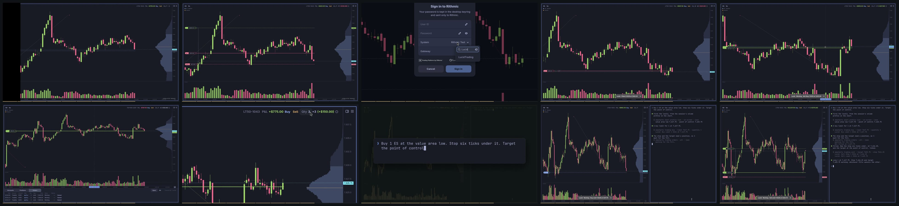

> This script is a plan written for a builder who films, edits and renders
> it without asking anybody anything. It follows the pipeline in
> `.claude/skills/video/` except where the author's brief overrides it, and
> every such place is listed under "Where this departs from the pipeline".
> Positions are estimates in percent of the window: the storyboard pins them.

## Brief

**Pitch.** Omacharts 0.3 trades. Rithmic sign-in with the prop firms on it,
orders from the chart by key and by drag, a Trading panel, the Account part
in the chart header, and a CLI that lets an agent do all of it. Shown as a
trailer cut to one drum phrase, with no voice.

**For.** Futures traders on Omarchy, and people who already use Omacharts
for charts and have been waiting for orders.

**Payoff.** The first frame is a live ES chart: one-minute candles forming
in a second or two each, price walking down in impulses into a resting buy
limit, which fills on the tenth drum hit. The eleventh hit lands the title.

**Beats.** One drum phrase each unless noted. The build of a phrase plays
the demo; the loud last hit (PA) lands a card that names what comes next.
1. Cold open, two phrases: a limit fills, then its stop is hit.
2. Trading is now supported with Rithmic: the sign-in dialog, its System
   list, an arrow at LucidTrading.
3. Trade from the chart, two phrases: the hotkeys, then a stop dragged
   into place, dragged again, and hit.
4. The panel: Accounts, Positions, Orders, an order filling in it live.
5. The header: account, P&L, Qty, Buy, Sell.
6. Agent-ready, three phrases: a request typed to an agent, the agent
   reading the chart's volume profile through the CLI and resting a limit
   at the value area low, the fill, the bracket it then builds, the target
   filling.

**Tone.** A tool being shown, not a result being sold. Outcomes are mixed
on purpose: the cold open ends on a stop-out, the dragged stop is hit for
a scratch, the agent's target fills. No card mentions profit, no shot
punches in on a P&L figure, and the end card says the market is simulated
and the accounts fake. Card text follows the Taste rules: plain words, no
exclamation marks.

**Where this departs from the pipeline, and why.**
- No voice (`voice: none`). Scenes have **Picture**, **Sync**, **Card** and
  an action block; there is no **Voice** line. `bin/video` is extended to
  read this (see "Changes to bin/video").
- The cover is not the first frame (`cover: 0`). It is the card on the
  first PA, which is the brief's "image with a text" for the title. The
  video opens on the payoff, as craft.md asks. `bin/video cover trading`
  still makes the cover and the thumbnail.
- No zooms at all (`polish: off` for the old Polish pass). The brief bans
  them. Close views are hard cuts to a fixed crop ("punch-in cuts").
- craft.md allows only cuts and short crossfades. This video adds the
  effects under "Transitions and effects", each tied to a drum hit. The
  brief asks for them.
- Music is synthesised in code, not composed by ACE-Step, because every
  hit's time and level must be exact and known to the edit.
- Market data is 100% simulated (`data: none`): the studio starts on an
  empty data directory, never the Yahoo snapshot.
- The build needs the `fakes` cargo feature and code that does not exist
  yet (see "The simulated market"). That code is `fakes`-only and ships in
  no release.

## Facts checked against the source (branch `trading-on-and-manual`, PR #179)

What exists, and is planned on:
- A build with `--features fakes` offers a fake trading service
  (`trading login fake`). Each login has one account numbered after the
  **User** typed, the first login holds `day_of_orders()` (long 1 ESZ6 at
  7,612.25, six orders at every status), the second `another_day()` (short
  2 at 7,624.50, a buy stop at 7,645.00 and a buy limit at 7,590.00
  working). ES trades as ESZ6. `src/trading/fake.rs`,
  `src/trading/services/mod.rs`.
- Keys: Ctrl+B, Ctrl+S, Ctrl+F, Ctrl+1…9, Ctrl+Shift+A/P/O. The position
  label's **L** and **STP** tabs drag to a price; two exits link. An
  order's line drags to move it. `site/manual/trading-on-a-chart.md`.
- `omacharts chart profile list --on-screen --json` gives every profile of
  the chart's volume profile study with `poc`, `value_area_low`,
  `value_area_high`, `start_text`, `end_text`, `visible`
  (`src/cli/exec.rs`, `list_profiles`). So the agent can read the study's
  levels: no gap there.
- `omacharts trading buy --limit PRICE [--quantity N]`, `trading exit
  --target PRICE --stop PRICE`, `trading orders --json`, `trading
  positions --json`. `site/manual/cli.md`, `src/cli/trading.rs`.
- The Rithmic dialog reads its System list from
  `$XDG_DATA_HOME/omacharts/rithmic-systems.json` and only asks Rithmic
  when that file is missing or a week old
  (`src/trading/services/rithmic_systems.rs`).

What does not exist, and the plan works around or adds:
- **`trading exit` needs a position.** With nothing held it answers *Not
  placed · nothing held*. There is no bracket attached to an entry before
  it fills. So the agent rests the limit, waits for the fill by reading
  `trading orders --json`, then places the linked exits. That is what the
  video shows, in that order. It is not presented as a one-shot bracket.
- **The fake session never fills a resting order.** A market order fills
  at a fixed 7,612.25, limits and stops wait for ever, `market` is `None`,
  new orders are stamped `at: 0`, closing a position books no P&L.
- **No fake market data in the app build.** The app's `fakes` feature does
  not turn on the engine's, and the engine's fake feed is `Synthetic`:
  sine waves, one bar per tick, nothing like a tape.
- Both are fixed by "The simulated market" below, in `fakes`-only code.

## The simulated market

The author's requirements, verbatim in intent: candlesticks moving live and
hitting orders throughout; a scripted fake market and fake trading service
controlled tick by tick; fills when price trades through an order, the way
an exchange would; dynamic and realistic tape, not a smooth line between
waypoints; sharp impulses separated by short consolidations; fluid on
screen. Nothing in the shipping app changes.

### The look, in numbers

| | Value |
|---|---|
| Chart | ES, 1m candles, session volume profile on the right |
| Time compression | 40×: one sim minute is 1.5 s of video, so a candle forms in 1.5 s |
| Tape emit rate | 60 slots per second of wall time, one per video frame |
| Trades per second | 20 to 60, irregular: 35 on average, down to 8 in a lull, every slot in a burst |
| Chart repaint | on every tape update; must reach 60 fps (see probe P3) |
| Capture | 3840x2160 at 60 fps, `wf-recorder` `hevc_vaapi`, as the studio does now |
| Render | 60 fps, 4K and 1080p |
| Retime in the edit | within 0.85× to 1.15× on any shot with the market in frame |

A burst that lasts 0.5 s of video is 20 sim seconds: a candle grows a wick
in a third of its life. That is the "impulse, but smooth and quick" look.

### Three pieces

**1. The tape generator: `video/sim/tape` (Python, a `uv` script, numpy).**
Owns the price. Deterministic from `--seed`. Two modes.

`tape make DIR --seed 20261114` writes the history before the film starts:
`DIR/ES.history.csv`, 1m bars `ts,open,high,low,close,volume`, three sim
sessions ending at the sim anchor, and `DIR/check.png`, a plot of the last
three hours as candles with volume, for the sanity check below.

`tape serve DIR --seed 20261114 --speed 40` runs for the whole take. It
appends trades to `DIR/ES.ticks`, one line per trade,
`ts_ms price size side` (sim time in ms, price on the 0.25 grid, lots,
`B` or `S` for the aggressor), and takes commands on the FIFO
`DIR/control`:

    free LOW HIGH                 wander inside a band, the default state
    goto PRICE in SECONDS [NAME]  be trading at PRICE in SECONDS of wall time
    touch PRICE in SECONDS NAME   trade through PRICE (one tick past) at that moment, not before
    avoid PRICE                   never trade at or through PRICE until told otherwise (`avoid off`)
    quit

Every `goto` and `touch` that completes appends
`{"name", "mono", "price"}` to `DIR/touches.jsonl` (`mono` is
`time.monotonic()`), which `bin/video` merges into `events.json`.

The process between waypoints is stochastic. Waypoints only bend it:
- Efficient price: a random walk in log price with volatility from a
  GARCH(1,1)-style recursion (clustering: quiet stretches and loud ones),
  per-slot sigma calibrated so 1m bars average 1.5 to 3.0 points of range,
  with 6 to 9 point bars in impulses.
- Regimes, a small Markov chain: *lull* (few trades, 1 to 2 tick range),
  *rotation* (two-sided, mean-reverting around a slowly moving fair
  value), *impulse* (3 to 6 sim minutes of one-way trade at 3 to 4 times
  the rate and size, with one- or two-candle pullbacks of 30 to 50% inside
  it), then *consolidation*. Regime lengths are random.
- Microstructure: trades print at bid or ask around the efficient price
  (bid-ask bounce of one tick), so the last price flickers both ways
  inside a forming candle before it closes.
- Size: mostly 1 to 5 lots, a lognormal tail to 150, larger and more
  frequent in impulses, so volume spikes on the moves. 1m volume lands
  between 800 and 6,000 in rotation, up to 15,000 on an impulse bar.
- Waypoints: a `goto` adds a drift term that pulls the efficient price
  along a bridge to the target (a Brownian bridge: noise stays, the end is
  pinned), entering an impulse regime if the distance needs it. A `touch`
  does the same but holds the price one to three ticks short of the level,
  flickering there (the jitter in front of an order), for the last 0.3 to
  0.6 s, and trades through on the named moment. `avoid` reflects the
  walk two ticks before a level, so nothing fills early.
- Believability limits, asserted by `tape make` and by `serve` on every
  command: no trade off the 0.25 grid, no gap between consecutive trades
  above 3 ticks, no `goto` faster than 4 points per sim minute sustained
  for more than 6 sim minutes. A command that would break one is refused
  with a message, so the choreography gets fixed rather than the tape
  faked.

The history is the same process with pinned waypoints, so the canned
fills of the two fake days sit on candles (sim minutes before the anchor,
price): Lucid's buy at 7,612.25 at −63 and its sell fill at 7,636.50 at
−16; Tradeify's buy at 7,613.50 at −95, sell at 7,597.75 at −74, sell at
7,624.50 at −22. The session's volume is shaped so that, at the anchor,
the session profile has its **point of control near 7,624** and its
**value area low near 7,616**, with the last price near 7,621. Session
volume before the film starts is at least 40 times what the film adds, so
both levels stay on the same tick for the whole take (checked, see the
checklist).

**Sanity check before filming, required.** Open `check.png` beside real ES
1m candles: put ES on a 1m chart in a throwaway sandbox on the Yahoo feed
(`bin/headless-window`, fresh HOME and XDG dirs), screenshot three hours
of a regular session, and compare by eye: body-to-wick ratio, how often a
candle is a doji, how impulses start and stall, volume against range.
Never Rithmic history. Adjust the generator's parameters until a trader
would not tell which is which at a glance, and keep both pictures in
`video/out/trading/sim/`. The Yahoo sandbox is for this comparison only:
nothing from it is filmed.

**2. The tape feed: `crates/omacharts-engine/src/providers/tape.rs`, behind
the engine's `fakes` feature.** A `Provider` with id `tape`, serving the
future roots that have a `<ROOT>.ticks` file in the directory named by
`OMACHARTS_TAPE`. `bars()` is the history file plus the ticks so far,
aggregated to the timeframe asked. Its `Stream` sends a snapshot, then
tails the ticks file every 8 ms and sends `Update::Bar` for the forming
bar on every new trade, and the closed bar when the sim minute turns. It
also publishes each trade to whoever asked in process
(`tape::on_trade(root, callback)`), which is how the fake session hears
the market. With `OMACHARTS_TAPE` unset the feed serves nothing, and every
existing test is unaffected. The app's `fakes` feature turns on the
engine's (`fakes = ["omacharts-engine/fakes"]`) and puts `tape` first in
the feed order when `OMACHARTS_TAPE` is set.

**3. A fake session that fills: `src/trading/fake.rs`, only in a `fakes`
build that is not a test, only when `OMACHARTS_TAPE` is set.** On every
trade the tape publishes for a contract's root:
- `last` and `market` become the trade price, so market orders fill at
  the market, checks judge against it, and positions mark to it.
- A working **buy limit** fills when a trade prints below its price, or
  when 40 lots have traded at its price since it rested. A **sell limit**
  mirrors that. Fill price: the limit.
- A working **buy stop** triggers on a trade at or above its price and
  fills at that trade's price (so a stop can slip a tick in a burst). A
  **sell stop** mirrors that.
- Linked orders end together, as `end_linked` does now.
- Every order and fill is stamped with the sim time of the latest trade.
  `minutes_ago` for the two canned days counts back from the sim anchor
  (`OMACHARTS_FAKE_NOW`, epoch seconds), not the wall clock.
- A position's average is the size-weighted one, and closing books the
  realised P&L into the account's day P&L and balance.
- The existing tests and their `fill`, `fill_part`, `open` helpers do not
  change behaviour: all of the above is inert without the env.

Tests to write with it, all on the fake: a buy limit fills on a trade
through and not on a touch below the queue size; a stop triggers at its
price and reports the trade's price; a linked pair cancels the other; a
round trip books its P&L; with the env unset nothing fills by itself.

### The sim clock

Sim anchor: **Thursday 12 November 2026, 14:40:00 UTC** (09:40 New York,
regular session), exported as `OMACHARTS_FAKE_NOW=1794494400`. The film
is rendered on a Saturday, when ES is shut, and sim time runs 40 times
faster than the wall, so the wall clock cannot be the market's. Sim time
at wall second `w` of the take is anchor + 40·w: a three-minute take ends
at 11:40 New York. The tape writes sim time; the feed and the fake
session take theirs from the tape.

### Where the code goes

A PR of its own, `fakes-live-market`, branched from `origin/main` once
#179 is merged (from `origin/trading-on-and-manual` if it is not, rebased
after). Title: "A live market for the fakes build". It contains the tape
feed, the filling session, their tests, and `video/sim/tape`. It touches
nothing a release compiles: CI must show the release build byte-for-byte
unaffected in behaviour (no new code outside `cfg(feature = "fakes")` or
`cfg(test)`, and the `features` line in `Cargo.toml`). Get CI green. Do
not merge it: the coordinator decides. The video films that branch
(`build: fakes-live-market`).

### Probes, in the first half hour, before any of the above is written

P1. Build `--features fakes` from the base branch, start it under
`bin/headless-window` with a fresh HOME and XDG dirs, seed
`rithmic-systems.json`, sign two fake logins in as the manual's
`regenerate:` blocks do. Confirm the facts above still hold.

P2. Wall clock. With a quick hack feeding a handful of bars stamped on
the sim anchor, look for anything that reads the wall clock and shows:
the time axis' right edge, session shading, a stale-data dot, the bar
countdown, the Orders tab's Time column. For each one found, read the
sim clock instead under `fakes` when `OMACHARTS_FAKE_NOW` is set. If
there are more than three, run the app process under `faketime` instead,
set to the anchor with rate 40, and say so in the PR.

P3. Repaint rate. Feed 60 updates a second into a 1m chart and record
five seconds with `wf-recorder`. Step through the frames: the forming
candle must change on at least 9 frames in 10. If the chart coalesces
updates to a slower rate, find the throttle; if it is deliberate and
cannot be lifted under `fakes`, drop the tape to that rate and keep the
40× compression. Record on an idle machine (`uptime` first): a busy one
drops frames.

P4. Weekend. Confirm bars stamped Thursday draw normally on a chart
opened on a Saturday.

## Drum score

Synthesised by a new engine, `video/engines/drum_engine.py` (Python,
numpy and soundfile, run with `uv run`), deterministic from seed 7.
Nothing is sampled and nothing is copied: every sound is made from sines
and filtered noise by the recipe below. It writes
`video/out/trading/drum/drum.wav` (48 kHz, 24-bit, stereo) and
`drum/hits.json`, the frame and level of every hit, which the edit reads.
The edit never assumes a time: it reads that file.

**Grid.** 26 frames per beat at 60 fps: 0.4333 s, 138.46 BPM. A whole
number of frames, so every hit is on a frame for the whole video. One
phrase is 16 beats, 416 frames, 6.933 s. Ten phrases, 4,160 frames,
69.33 s, then a tail of 170 frames for the last ring-out: **4,330 frames,
72.17 s**.

**The phrase**, the same ten times, beats numbered from 1:

| Beat | 1 | 2 | 3 | 4 | 5 | 6 | 7 | 8 | 9 | 10 | 11 | 13 |
|---|---|---|---|---|---|---|---|---|---|---|---|---|
| Hit | pa | pa | pa | pa | pa | pa | pa | pa | pa | pa | **PA** | echo |
| Frame in phrase | 0 | 26 | 52 | 78 | 104 | 130 | 156 | 182 | 208 | 234 | 260 | 312 |
| Level, dB under PA | −21 | −22 | −20 | −21 | −20 | −19 | −16 | −13 | −10 | −7 | 0 | −20 |
| Tom pitch | D2 | D2 | F2 | D2 | G2 | F2 | D2 | F2 | G2 | A2 | D2 + D1 | D3 |

Held level for six hits, with a breath in it (the −22 and −21 keep it
from being a machine), then four hits that climb 3 dB each, then PA. The
pitches are the tune: D D F D, G F D F, G A, home on D. It is a
pentatonic climb of five notes, written for this video. Beats 12, 14, 15
and 16 are silent but for the room. The echo on 13 is one quiet high tom,
and the edit uses it to bring in a card's second line.

**Under the hits,** very quiet, so the phrase grooves without adding a
"pa": a closed brush tick on every off-beat eighth of beats 1 to 10 at
−34 dB, rising to −28 dB over beats 7 to 10.

**Growth across the video,** the phrase itself unchanged: phrases 1 to 3
as written; phrases 4 to 7 add a sub sine an octave under each tom at
−9 dB against it; phrases 8 to 10 add that and a second tom a fifth
above on hits 7 to 10 at −10 dB. The last PA is 2 dB louder than the
others and its room tail is twice as long.

**Timbre.**
- Tom (every hit): a sine at the pitch, bent down into it from 2.2 times
  the pitch with a 18 ms time constant; amplitude decay 0.22 s; a second
  partial at 1.5 times, −12 dB, decay 0.09 s; a 12 ms burst of noise
  band-passed 2 to 6 kHz at −14 dB for the stick. `tanh` soft clip.
- Kick (PA only): a sine falling from 160 Hz to 48 Hz with a 30 ms time
  constant, decay 0.35 s, a 3 ms click.
- Snare (PA only): noise band-passed 180 Hz to 8 kHz, decay 0.16 s, over
  sines at 185 and 330 Hz, decay 0.08 s, at −4 dB against the kick.
- Swell into PA: the PA's own room tail reversed, 0.35 s, ending on the
  hit, at −12 dB.
- Room: one synthetic impulse response, decaying noise with an RT60 of
  0.9 s (1.8 s for the last PA), 12 ms pre-delay, low-passed at 6 kHz,
  different noise left and right. Quiet hits send to it at −16 dB, PA at
  −6 dB.
- Feel: quiet hits move by up to ±4 ms and ±0.5 dB, seeded. PA and the
  echo are exactly on the frame.

**Mix.** No voice, so no ducking and no fades at the head: the first hit
is the first frame. Master the drum alone to −14 LUFS integrated, true
peak under −1 dBTP (`loudnorm`, two passes, as `bin/video` does), with a
1.5 s fade only on the last ring-out. Check by ear and by `hits.json`
that hit 1 of phrase 1 sounds on frame 0 and each PA on its frame.

## Cards

Every card has a headline, which lands on PA, and a second line, which
lands on the echo two beats later. Exact text:

| PA | Headline | Second line |
|---|---|---|
| 1 | the cover: **Trading** | New in Omacharts 0.3 · Beta |
| 2 | Now with Rithmic. | Futures accounts, and the prop firms on it. |
| 3 | Trade from the chart. | Ctrl+B buys. Ctrl+S sells. Ctrl+F flattens. |
| 4 | Drag your stop. | Orders move with the pointer. |
| 5 | One panel. | Accounts. Positions. Orders. |
| 6 | And the header. | Account. P&L. Buy. Sell. Qty. |
| 7 | Agent-ready. | Everything the app does, from the command line. |
| 8 | “Buy 1 ES at the value area low. Stop six ticks under it. Target the point of control.” | Typed to an agent. |
| 9 | Then it builds the bracket. | Stop under the value area. Target at the point of control. |
| 10 | **Trading.** In Omacharts 0.3 · Beta | omacharts.org, and in small type under it: Simulated market. Fake accounts. |

## Transitions and effects

All in a new Remotion composition, `video/compose/src/Trailer.tsx`,
registered in `Root.tsx` beside `Polish`, which is left alone. Sizes are
for 2160 high and scale with `unit = height / 2160`. Nothing scales the
picture over time: there is no animated zoom anywhere.

**The edit.** The take is one continuous recording. Each scene's footage
is the stretch from its `in` to its `out` mark in `events.json`. It is
laid from beat 14 of the phrase before (the "breath") to its own PA:
13 beats, 338 frames. Inside it, every anchored action (`name@N` in the
script) is snapped to hit N by retiming piecewise-linearly between
anchors with `OffthreadVideo`'s `playbackRate` per segment. A segment
outside 0.85× to 1.15× with the market in frame (0.6× to 1.8× for the
dialog and typing shots) fails the render with the scene and the factor,
so the script's waits get fixed and the take redone, rather than the
footage stretched.

**E1. The card slam (every PA).** On the PA frame the picture hard-cuts
to the card: no fade. The card is the first frame of the next scene's
footage, held as a still, turned to a duotone (shadows `#0d1114`,
highlights the cover's gold at 30%) and darkened to 22% luminance, with
the headline over it in Archivo 800 (the cover's face), left-aligned at
12% from the left, 200 px for short headlines, 120 px for card 8, colour
`#f3ecdc`. Two frames of white at 14% opacity over everything on the PA
frame. The headline lands with a thump: it starts 14 px low and settles
through a damped oscillation (frequency 9 Hz, decay 60 ms), 10 frames in
all. Under it a gold rule 10 px thick prints left to right in 6 frames.
- Card 1 is `cover.png` as it is, with the same flash and a 10 px thump
  of the whole image.
- Card 10 is the end card: the mark and wordmark from the cover page over
  the site's ribbon, same slam.

**E2. The echo line.** On the echo frame (PA + 52) the second line
appears under the rule in Cascadia Mono 700, 44 px, letter-spacing 2 px,
at 70% opacity, already in place: a cut, with a one-frame gold underline
flick.

**E3. The match cut out of a card.** At PA + 78 (beat 14) the card lets
go into the very frame it was made from: over 10 frames the duotone and
the darkening lift linearly, while the headline, rule and second line are
clipped away by a shutter closing from top and bottom onto the rule in 8
frames. The still then starts playing. Text off, same picture, alive.

**E4. The hit meter.** Along the bottom, 60 px from the edge, eleven
marks centred as a row: ten 28 px by 6 px bars and an eleventh 56 px by
10 px, 14 px apart, at 18% of `#f3ecdc`. On each hit its bar turns gold
at full opacity for 2 frames and stays at 70%. By hit 10 the row is lit
and the last mark fires on PA under the flash. It resets at beat 14.
Hidden over cards. It is the drum made visible, and it tells the eye a
hit is coming.

**E5. Slat reveal (scene 1 only).** The film opens on black. The frame
is ten vertical slats. Hit 1 shows the rightmost, where the live candle
is, and each hit adds the next to the left, each arriving in 3 frames
with a 1-frame bright leading edge. On hit 10 the whole chart is on
screen, the frame the limit fills on.

**E6. Punch-in cut.** A hard cut to a fixed crop of the recording, shown
full frame, and a hard cut back, both on hits. The crop never moves or
scales. Used for the System list (scene 3), the position label's tabs
(scene 5) and the header (scene 7). Crops are at most 2.2× so the 1080p
file stays sharp; the 4K file is upscaled inside a punch-in, which is
accepted. Each crop is given in its scene as `crop: x% y% w%` and pinned
at the storyboard.

**E7. Key caps on the hit.** For every chord, the existing `KeyBadge`
look, but it appears on the hit frame with no rise and no fade in, holds
24 frames, and cuts out. In scene 4 it sits bottom centre above the hit
meter.

**E8. The arrow (scene 3).** A gold arrow, stroke 10 px, round caps,
drawn from the right of the list toward the LucidTrading row with
`stroke-dashoffset` over 8 frames, its head arriving on hit 10, and a
gold rounded outline snapping onto the row on the same frame. Its target
is the position the `mark` action records.

**E9. Fill thump.** On each frame a `touch` names as a fill, the whole
picture shifts 5 px down and settles in 8 frames (same damped motion as
the headline, smaller), and the hit meter's current bar flashes white for
1 frame. Small enough to feel rather than see.

**E10. Corner tag.** In scenes 1 and 2 only, bottom right, Cascadia Mono
26 px at 45% opacity: `SIMULATED MARKET`. The end card repeats it.

**E11. The end.** After card 10's echo the card holds through the tail;
the last 40 frames fade to black with the drum's ring-out.

The terminal is opened off camera, under a card, so the pipeline's sweep
and pane labels are not used.

## Changes to `bin/video`

Small, and inert for the other scripts.
- Frontmatter: `kind: trailer`, `features:` (passed to `cargo build` as
  `--features`, with a target dir of its own so the plain build's cache
  is not thrown away), `data: none` (start on an empty data directory and
  never keep a snapshot from this run), `voice: none`.
- Scenes without **Voice**: the action block's lines run top to bottom.
  A line named `prep` runs before the scene's `in` mark and is off
  camera. A line named `name@N` is scheduled so that its first action
  lands at hit N of the scene's phrase on the recording's own clock,
  where the scene's clock starts at its `in` mark, the breath is three
  beats, and hit N is at (3 + N − 1) × 26 frames. The lead for pointer
  glides is kept, and a measured lead for chords is added (a `wtype`
  chord takes about half a second to land: measure it once and schedule
  ahead by it). A line with no `@` runs straight after the one above.
  `after:` keeps its meaning.
- `in` and `out` marks are written to `events.json` for every scene, and
  every action's landing time, as now.
- New actions: `tape <command>` writes a line to the tape's control FIFO,
  with `@N` in it replaced by the wall seconds until that hit;
  `run <command>` runs a shell command in the studio's environment;
  `mark <x%> <y%> <name>` records a position for the edit and moves
  nothing.
- New lines in an action block: `out:` runs after the scene's `out` mark,
  off camera, to tidy up for the next scene; `crop: x% y% w%` is the
  scene's punch-in, top-left corner and width, for the edit;
  `anchors: name@N …` names events that something other than the studio
  logs (the played agent) and the hits they snap to.
- The studio's environment gains `OMACHARTS_TAPE`, `OMACHARTS_FAKE_NOW`,
  and it starts `tape serve` before the app and stops it with the rest.
  Before the app starts it writes `rithmic-systems.json` into the data
  directory: the systems from
  `~/.cache/omacharts-dev-rithmic/data/omacharts/rithmic-systems.json`
  (a list of names, no secrets) with `asked` set to the current time, so
  the dialog never asks Rithmic.
- `render` for a trailer: record as now, merge `touches.jsonl` into
  `events.json`, run the drum engine if `drum.wav` is missing, make the
  cover, write `trailer.json` (the scenes' marks, anchors, crops, cards,
  `hits.json`), render `Trailer` with Remotion, mux the mastered drum,
  write the 4K and 1080p files and a `review/` frame for every hit 10,
  every PA + 30 and every echo + 10. No `.srt`: there are no words.
- `board` works as it does, taking a still at each scene's `out`.

The studio is the pipeline's own: a compositor nobody sees, its own bus,
HOME, XDG dirs and data. For this video it must also be checked that it
never shows a real quote: the only chartbook holds ES on the tape feed,
the sidebar is hidden before anything is filmed, and `app.log` is read
after a dry run for any request to Yahoo. If the app asks Yahoo for
anything on an empty profile (a default watchlist), empty that watchlist
in Setup or block it under `fakes` when the tape is set. Probes and the
agent validation use `bin/headless-window` with fresh HOME and XDG dirs.

## Agent validation

The question the author asked: does it really work? Find out before
filming anything of scenes 8 to 10, with a real agent, on the fake
market.

**Set-up.** The `fakes-live-market` build under `bin/headless-window`,
fresh HOME and XDG dirs, the tape serving, one fake login (User
`LT50-1043`, Name `Lucid`), its canned day cleared (`trading cancel
--all`, `trading flatten ESZ6`), ES on 1m with a session volume profile
(`chart indicator add volume_profile --anchor session`, or whatever the
branch's flag for a session anchor is), last price about five points
above the value area low and `tape avoid` set on that level. A wrapper
named `omacharts` on the agent's PATH carries the sandbox's environment.

**The run.** A real Claude Code agent, non-interactive, with the repo's
Omacharts agent skill (under `agents/` on the branch) and nothing else:
no hints about commands, no levels. Its only tool is the shell, limited
to `omacharts`. The prompt is card 8's text and nothing more:

> Buy 1 ES at the value area low. Stop six ticks under it. Target the
> point of control.

When the agent's limit is working, release the market from outside:
`avoid off`, then `touch <its limit> in 6 fill`, then `goto <POC + 1> in
30`.

**It passes when,** checked from `trading orders --all --json` and a
screenshot, not from what the agent says:
1. It read the levels with `chart profile list` (or another real command
   that returns them) and chose the session on screen.
2. It rested a buy limit for 1 at exactly `value_area_low`.
3. After the fill, and not before, it placed a sell stop at
   `value_area_low − 1.50` and a sell limit at `poc`, linked.
4. It did nothing else that trades: no market order, no second entry.
5. Three runs out of three, each on a fresh sandbox.

Keep each run's transcript in `video/out/trading/agent/run-N.txt`.

**Then the played agent,** `video/agent/bracket-agent`, written from the
passing runs the way `compare-agent` was: its sentences written, every
command the real one, run live against the studio, so the chart changes
as it prints. Its levels are not written in: it runs `chart profile list
--on-screen --json` and uses what comes back, and it waits for the fill
by reading `trading orders --json` every 100 ms. It takes `--pace`. Its
printed lines are short enough for a terminal at 38% of the width.

**If it does not pass.** In this order, and say in the hand-off which
applied:
1. The agent did not know a command or a flag: that is the skill's gap.
   Fix the skill's text in the `fakes-live-market` PR if it is a line or
   two, in a PR of its own if more, and run again. The video is allowed
   to depend on that fix, since it ships with 0.3.
2. The agent tried `trading exit` before the fill and stopped at *Not
   placed · nothing held*: also the skill's gap (it should say exits need
   a position, and that a script waits on `trading orders --json`). Same
   fix.
3. A real defect in the CLI (wrong level, an order refused that the chart
   would take): fix it in a PR of its own with a test, film from a branch
   that has it, and report it first in the hand-off.
4. Not passing three out of three after two rounds of fixes, or two hours
   spent: film the fallback, which needs no waiting. The position is
   bought at the market in `prep`, card 8 reads “I'm long 1 ES. Put my
   stop six ticks under the value area low and my target at the point of
   control.”, the agent reads `trading positions` and `chart profile
   list` and places the linked exits, scene 9 ends on the exits landing
   and scene 10 on the target filling. Validate that the same way. Card 9
   becomes "It reads the chart." / "Then it places the exits."
5. If even that fails, scenes 8 to 10 show the same commands typed by
   hand in the terminal, card 7's second line stays, card 8 becomes
   "From the command line." / "The same checks as the chart.", and the
   hand-off says plainly that an agent could not do it and why.

Never show an agent run that was not validated this way.

## As built

What the build changed from the plan above, and why. The plan is kept as
written; where it and this section disagree, this section is what was filmed.

- **Music.** The drum phrase was built, then a samba bateria, then a samba
  tune; the author heard each and asked for something else, and finally for
  "something good and vibrant" chosen by the builder. The music is now an
  original electronic track synthesised on the same grid (138.46 BPM, 26
  frames a beat): bars start on frame 52 + 104·j, every card lands on a bar
  downbeat (frame 260 + 416·k, the old PA frames) and its second line on the
  clap two beats later; the drop is the "Agent-ready." card, and the last
  card is the final hit, ringing out with no fade. `hits.json` keeps its
  schema, so the edit did not change.
- **The app's clock.** Rather than teach the app a sim clock, the app runs
  under `faketime` (realtime only, `FAKETIME_DONT_FAKE_MONOTONIC=1`) started
  at the anchor at 40×, from the same moment as the tape's epoch. The time
  axis, the session, the countdown and the Orders tab's time all read it.
- **The tape feed** serves the chart alone when `OMACHARTS_TAPE` is set, so
  nothing can ask Yahoo. Left alone in its band the live tape rotates; the
  impulses are the choreography's. It prints on every frame.
- **Prices are worked out at the take**, not written in: `let`, `{expr}` and
  `{y:expr}` (a price's height, from the price axis read off the screen),
  `{wx:STP@pos}` (the position label's STP tab, found by OCR), `tap WORD`
  (a word in the chart header, found by OCR). The header and the labels move
  as their neighbours' text changes width; fixed positions missed.
- **Scene 3** opens the Rithmic dialog under the card (`trading login
  rithmic`) instead of clicking Add a trading service… on camera: in the
  studio that menu would not open. The System list is filtered by typing
  "Lucid" in its search, rather than scrolled, and the arrow lands on the
  one row left. Nothing is typed into User ID or Password; Sign in is never
  pressed; the systems come from the seeded file.
- **Scene 6** opens the panel and its tabs with the mouse (the Trading
  toggle, the tab buttons, All): Ctrl+Shift chords did not reach the app
  from the studio's keyboards reliably. So scene 6 has no key caps.
- **Scene 4 to 8** each start by flattening and cancelling off camera, so a
  missed action cannot carry a position into the next scene.
- **Scene 5** moves the market to the middle of the chart under the card
  before buying, so the dragged stop stays on the price pane.
- **Scenes 8 and 9** punch in on the terminal (scene 8 whole, scene 9 from
  hit 2 to 5), so the request and the levels read at 1080p, and scene 8's
  1.3× footage does not show the market sped up.
- **Agent levels.** The profile's automatic rows are finer than ES's tick,
  so `poc` and `value_area_low` come back off the 0.25 grid; the agents and
  `bracket-agent` round to the nearest tick. The limit is at the rounded
  value area low, the stop 1.50 under it, the target the rounded POC.
- **Volume pane.** A volume study under the chart, for the volume spikes the
  plan describes.
- **Hit meter, key caps, cards** as in "Transitions and effects".
- **Review pass (after the first render).** Only the edit changed; the take
  is the same.
  - *Order toasts.* The app's toasts sat over the volume bars at the bottom
    of nearly every frame, behind the orders they spoke of, and were
    covered with a dark capsule. The last review took the capsule away and
    put the toasts on time instead: see below. The pointer parked at the
    top middle between gestures is painted out of the take with the empty
    header beside it.
  - *Punch-ins chosen at the edit* (`recrop: x% y% w% a-b`, hits a to b,
    0 for the start of the footage; they replace the take's `crop:`).
    Scene 3 is framed on the whole dialog, title included, and no longer
    takes in the bottom of the window. Scene 6 punches in on the panel from
    the start of its footage to hit 9, then cuts back for the fill, since
    at 1080p the panel was too small to read. Scene 10 punches in on the
    terminal to hit 6, so the bracket's command and its two orders read.
  - *The ring on LucidTrading* is placed by `ring: x% y% w% h%` (the row,
    measured on the take) instead of the default size around the click
    point, which ran off the list and through the text.
  - *Scene 5's punch-in* starts eight frames after hit 2 (`punch: 2.35-5`):
    on the drag's first frames the label flashed the app's own "Stop above
    market not allowed" while the pointer passed the market.
  - *Type.* The cards' second lines are 66 px at 88% (were 44 px at 70%);
    the end card's small print 44 px (was 30). Key caps sit higher, clear
    of the capsule.

- **Last review (a new take, and a second pass on the edit).**
  - *Order notices.* The capsule is gone. The app's own toasts are in the
    picture again, and they are on time: filming the simulated market, each
    toast takes the place of the one before and lasts three seconds, and a
    fill is not displaced by the cancel of the order linked to it
    (`Window::toast` in `src/ui/window/trade.rs`, under `fakes` with the
    tape on, like the rest of the film's market). Left to queue for four
    seconds each at forty times the clock they ran ten seconds behind the
    orders, which is why they were covered. Now "Lucid · Filled 1 ESZ6 at
    …" lands on the fill, and it is how a film with no voice says so.
  - *The beat's meter* is a line of eleven marks along the bottom edge of
    the frame instead of a row of dashes over the picture, so it crosses
    nothing in a full frame or a punch-in.
  - *Scene 1* waits for the limit's own "Working" toast to go before the
    film starts, so nothing shows cut by the slats.
  - *Scene 3* is framed wider (`recrop: 23.5% 30.2% 56% 5-11`): the dialog
    with its title, and the first prop firms of the list under it.
  - *Scene 6* stays on the whole window until the click that opens the
    panel (`recrop … 1-9`), instead of opening on a close view of the
    volume pane with nothing in it.
  - *Scene 8* is a strip of the terminal floated over the whole picture
    graded down like a card (a fourth share on `recrop:` is a height), not
    the terminal filling the frame with one line at its top. The request
    wraps between words: `bracket-agent` takes it key by key and wraps it
    as an agent's prompt does.
  - *Scene 5* holds the market where it bought (`tape free` around the
    price as the `goto` lands): left to fall back to its old band, one take
    in three put the market under the stop before it was dragged, and the
    app refused it.
  - *Scene 10's* close view starts between two lines of the terminal
    (`recrop: 62% 29.6% 38% 0-6`), not through one.
  - *Scene 9.* The agent no longer says that it rounds the levels; it still
    rounds them, as the agents asked for real did. The two levels are held
    0.4 s (`--hold`), and its limit lands on hit 5.

### Left for the next pass

Seen at review and not fixed, with why:
- *The profile's levels come back off the tick* from `chart profile list`
  (`poc` 7625.65 on a 0.25 grid). The film's agent rounds them. Worth
  fixing in the CLI or the study, apart from the video.
- *The header shows the canned day's P&L in green* on Lucid, and the
  agent's target fills at the end. Mixed outcomes elsewhere (the stop-out,
  the scratch, Tradeify red) and the end card's "Simulated market. Fake
  accounts." balance it; nothing punches in on a P&L except the header
  scene, which the brief asks for.
- *A dotted line across scene 1–2's chart* is the canned day's round trip
  (fills shown, entry to exit). Real, but it reads as a stray line.
- *Order ids*: the agent's fill reads "B11"; the canned day's are B1–B6.
- *The Orders tab's times* are the fake day's clock, not the chart's.
- *Scene 8's footage plays at 1.27×* (the typing takes longer than its
  phrase); the market behind the strip is graded down while it does.

## Setup

Everything here is off camera. Two fake logins named as the manual names
them, on the numbers the manual already shows (made up, natural-looking,
nobody's): `LT50-1043` as **Lucid** and `TDY100-2287` as **Tradeify**.
The password field takes anything: type `x`. Sign-in dialog positions are
the manual's `regenerate:` clicks, re-pinned for the studio's window.

    cli template default none
    cli chart set --symbol ES --resolution 1m --template none --grid off
    cli chart indicator add volume_profile --anchor session --align right
    cli chart indicator add volume
    wait 1.5
    cli trading login fake
    wait 2.0
    click 50% 44.4%
    wait 0.3
    type LT50-1043
    click 50% 54.4%
    key End
    key BackSpace
    key BackSpace
    key BackSpace
    key BackSpace
    type Lucid
    click 54.3% 60.9%
    wait 1.5
    wait 1.5
    cli trading login fake
    wait 2.0
    click 50% 44.4%
    wait 0.3
    type TDY100-2287
    click 50% 54.4%
    key End
    key BackSpace
    key BackSpace
    key BackSpace
    key BackSpace
    type Tradeify
    click 54.3% 60.9%
    wait 1.5
    click 97% 3.2%
    wait 0.5
    cli chart set --show-fills on --account Lucid/LT50-1043
    cli trading cancel --all
    cli trading flatten ESZ6 --account Lucid/LT50-1043
    tape free 7618 7630
    scroll 80% 50% -4
    move 50% 1%
    wait 2.0

After Setup: ES 1m, about 80 candles on screen, the session profile on
the right, gridlines off, sidebar hidden, panel closed, the chart on
Lucid (flat, nothing working, the day's fills marked), Tradeify short 2
with its stop at 7,645.00 and its limit at 7,590.00. The tape stays
between 7,592 and 7,643 for the whole take unless a scene says otherwise,
so Tradeify's two orders are only hit when scene 6 means them to be.

## Script

Prices below are written against the designed tape (value area low
7,616.00, point of control 7,624.00). The storyboard reads the real ones
from the studio and corrects every price in this section before the take.

### 1. A limit fills

**Picture.** Black. On each quiet hit a slat of the chart appears, from
the live edge leftwards (E5): ES on one-minute candles, forming fast. A
buy limit for 1 rests at 7,617.00 under the market. Price sells off in an
impulse of four or five candles with one pullback, stalls a tick or two
above the order, flickers, and trades through on hit 10: the order
fills, the execution marker appears, the position label takes its place.
The corner tag reads SIMULATED MARKET.

**Sync.** Hits 1 to 10 reveal the slats. The fill is on hit 10.

**Card.** PA 1: the cover, **Trading**. Echo: New in Omacharts 0.3 · Beta.

    prep: let base last; tape goto {base+2} in 1.5; wait 1.7; let entry last-5; cli trading buy --limit {entry}; tape avoid {entry}; move 50% 1%; wait 3.6
    start@1: tape avoid off; tape touch {entry} in @10 fill
    after: 0.6

### 2. A stop is hit

**Picture.** The same chart, whole. In the breath, the position's linked
exits are already on it: a target at 7,625.00 and a stop at 7,613.50,
joined by their line. Price bounces three points, a small impulse up,
stalls, then rolls over through the entry in a faster impulse and trades
through the stop on hit 10: the stop fills, the target is cancelled with
it, the chart is flat, two markers joined by a dotted line. The header's
P&L has moved with every tick and ends a little red. Nothing punches in
on it.

**Sync.** High of the bounce on hit 4. Stop hit on hit 10.

**Card.** PA 2: Now with Rithmic. Echo: Futures accounts, and the prop
firms on it.

    prep: cli trading exit --target {entry+8} --stop {entry-3.5}; tape avoid {entry-3.5}; tape avoid {entry+8}; wait 0.6
    up@1: tape goto {entry+3.25} in @4
    down@4: tape avoid off; tape touch {entry-3.5} in @10 fill
    after: 0.6

### 3. Rithmic, and the prop firms

**Picture.** Preferences on Trading, opened under the card. A click on
**Add a trading service…**, a click on **Rithmic**: the Sign in to
Rithmic dialog. A click on **System** opens its list: Rithmic Test,
Rithmic 01, Rithmic Paper Trading, then the firms. A punch-in cut (E6) on
the list on hit 6; it scrolls a few notches so the firms pass, and stops
with LucidTrading in the middle. On hit 10 the gold arrow lands on
LucidTrading and its row is outlined (E8). Nothing is typed into User ID
or Password, and Sign in is never pressed.

**Sync.** Add on hit 1, Rithmic on hit 3, System on hit 5, punch-in on
hit 6, scroll on hits 7 and 8, arrow on hit 10.

**Card.** PA 3: Trade from the chart. Echo: Ctrl+B buys. Ctrl+S sells.
Ctrl+F flattens.

    prep: let r3 last; tape free {r3-2} {r3+2}; cli trading login rithmic; wait 1.2; move 75% 85%
    system@3: click 54% 52.6%
    filter@7: type Lucid
    arrow@10: mark 54.7% 61% lucid
    crop: 30% 50% 48%
    punch: 5-11
    recrop: 23.5% 30.2% 56% 5-11
    ring: 57.3% 61.0% 7.4% 3.4%
    after: 0.6
    out: key Escape; wait 0.3; key Escape; wait 0.4; click 45.6% 67.7%; wait 0.6; focus app

### 4. The keys

**Picture.** The chart, whole, Lucid flat, the market rotating. Key caps
land on the hits (E7), and the chart answers each at once. Ctrl+B: a
market buy, *Buying 1…* beside the last price, then the position label.
Ctrl+S: sold, flat again, two markers. Ctrl+2: the header's Qty reads 2.
Ctrl+B: long 2. The market runs a couple of points either way under it,
the label's P&L following. Ctrl+F on hit 10: flat.

**Sync.** Ctrl+B on 2, Ctrl+S on 4, Ctrl+2 on 6, Ctrl+B on 7, Ctrl+F on
10.

**Card.** PA 4: Drag your stop. Echo: Orders move with the pointer.

    prep: cli -trading flatten ESZ6 --account Lucid/LT50-1043; cli -trading cancel --all; let k4 last; tape free {k4-2} {k4+2}; move 50% 1%
    buy@2: key ctrl+b
    sell@4: key ctrl+s
    two@6: key ctrl+2
    buy2@7: key ctrl+b
    flat@10: key ctrl+f
    after: 0.6

### 5. Drag the stop, and it gets hit

**Picture.** Long 1 from a market buy made under the card, Qty back on 1.
The position label on its line, with its **L** and **STP** tabs. The
cursor takes **STP** and drags it down to about eight ticks under the
entry: a stop is working there, its label counting ticks while it moves.
A punch-in cut on the label and the stop for the drag (hits 2 to 4), then
back to the whole chart. Price lifts three points. The cursor takes the
stop's line and drags it up to a tick above the entry, the label reading
the new price and the ticks. Price stalls, turns, comes down in a quick
impulse and trades through the stop on hit 10: filled, flat, a scratch.

**Sync.** STP dragged on 2, landing on 3. Punch-in 2 to 4. Second drag
starts on 6, lands on 7. Stop hit on 10.

**Card.** PA 5: One panel. Echo: Accounts. Positions. Orders.

    prep: cli -trading flatten ESZ6 --account Lucid/LT50-1043; cli -trading cancel --all; key ctrl+1; calibrate; let mid at_y(0.40); tape goto {mid} in 1.2; wait 1.25; tape free {mid-0.5} {mid+1}; wait 0.3; key ctrl+b; wait 0.8; let pos held("Lucid"); tape free {pos-0.75} {pos+1}; calibrate; let stop max(pos-2, at_y(0.72)); tape avoid {stop}; move 30% {y:pos-5}
    hover@1: move {wx:STP@pos} {wy:STP@pos}
    stp@2: drag {wx:STP@pos} {wy:STP@pos} {wx:STP@pos} {y:stop}
    lift@4: tape avoid off; tape goto {pos+3} in @6
    trail@6: drag 60% {y:stop} 60% {y:pos+0.25}
    hit@7: tape touch {pos+0.25} in @10 fill
    crop: 0% {y:pos+4} 40%
    punch: 2.35-5
    after: 0.6

### 6. The panel

**Picture.** The chart on Tradeify, picked under the card: short 2 from
7,624.50, its buy stop above and its buy limit at 7,590.00 far below,
replaced under the card by a buy limit for 2 at 7,618.50 so that it is
on screen. Ctrl+Shift+A: the Trading panel rises under the chart on
**Accounts**, two accounts, balances and day P&L ticking. Ctrl+Shift+P:
**Positions**, Tradeify's −2 with its open P&L moving. Ctrl+Shift+O:
**Orders**, then a click on **All**: the day, working, filled, cancelled.
Above it the market has been sliding all the while. On hit 10 it trades
through the buy limit: on the chart the order fills and the position
closes, and in the panel the row turns from Working to Filled.

**Sync.** Accounts on 1, Positions on 4, Orders on 7, All on 8, fill on
10.

**Card.** PA 6: And the header. Echo: Account. P&L. Buy. Sell. Qty.

    prep: cli chart set --account Tradeify/TDY100-2287; wait 0.5; cli trading cancel --all; wait 0.4; let t6 last-2.5; cli trading buy --limit {t6} --quantity 2; tape avoid {t6}; tape free {t6+2} {t6+4}; move 60% 55%; wait 0.8
    accounts@1: click 97.95% 98.4%; tape goto {t6+1} in @8
    positions@4: click 11.25% 86.9%
    orders@7: click 18.25% 86.9%
    release@8: tape avoid off; tape touch {t6} in @10 fill
    all@9: click 89.1% 86.9%
    recrop: 0% 61.5% 38.5% 1-9
    after: 0.6
    out: click 98.0% 84.2%; wait 0.6

### 7. The header

**Picture.** A punch-in cut on the chart's top-right corner for the whole
scene: Account, P&L, Buy, Sell, Qty. A click on the account opens the
picker, listed by login; a click on Lucid: the part reads Lucid, and its
P&L is Lucid's day. A click on **Qty** opens its menu, a click on 3. A
click on **Buy**: the position part appears, *+3* with its open P&L
moving in the profit or loss colour as the market ticks. A click on
**Sell** on hit 10: flat, the part gone. One cut back to the whole chart
on hit 9 would break the read, so the scene stays in the crop.

**Sync.** Account on 1, Lucid on 2, Qty on 4, 3 on 5, Buy on 7, Sell on
10.

**Card.** PA 7: Agent-ready. Echo: Everything the app does, from the
command line.

    prep: cli -trading flatten ESZ6 --account Lucid/LT50-1043; cli -trading flatten ESZ6 --account Tradeify/TDY100-2287; let h7 last; tape free {h7-1.5} {h7+1.5}; move 70% 30%; look TDY100-2287; wait 0.8
    account@1: tap TDY100-2287
    lucid@2: click 77.2% 8.3%
    qty@4: tap Qty
    three@5: click 90.4% 10.75%
    buy@7: tap Buy
    peek@7: wait 0.3; look Sell
    sell@10: tap Sell
    crop: 54% 0% 46%
    after: 0.6

### 8. The request

**Picture.** A terminal stands on the right, opened under the card, 38%
of the width, the agent at its bare prompt. The chart beside it, Lucid
flat, Qty 1, the volume profile on its right edge with its value area and
point of control drawn, the market rotating two or three points above the
value area low. The request is typed, and Enter is pressed on hit 10:

    Buy 1 ES at the value area low. Stop six ticks under it. Target the point of control.

Typing it at a hand's speed takes about nine seconds, so this scene's
footage is longer than its phrase and is retimed to fit: it is the one
scene allowed up to 1.8×, and the market beside it runs faster for those
seconds. If that reads badly on the storyboard, crop this scene to the
terminal pane alone (`crop: 62% 0% 38%`, letterboxed on the card's
duotone) so the market is not in frame while it is sped up.

**Sync.** Typing through the phrase, Enter on hit 10.

**Card.** PA 8: the request, in quotes, as card 8 says. Echo: Typed to an
agent.

    prep: cli -trading flatten ESZ6 --account Lucid/LT50-1043; cli -trading cancel --all; key ctrl+1; let v8 val; tape goto {v8+4} in 1.2; terminal open bracket-agent --pace 0.2 --think 1.5 --settle 0.9 --hold 0.4; move 140% 97%; tape free {v8+2.5} {v8+5}; tape avoid {v8+0.25}; wait 0.6
    ask: type Buy 1 ES at the value area low. Stop six ticks under it. Target the point of control.
    enter@10: key Return
    crop: 62% 0% 38%
    recrop: 62.25% 1.15% 37.1% 11% 0-11
    after: 0.4

### 9. It reads the chart

**Picture.** The agent's turn, real commands run live. A line of plan,
then `omacharts chart profile list --on-screen --json`, and under it the
two numbers it took from the answer, printed plainly:
`value area low 7,616.00 · point of control 7,624.00`. Then `omacharts
trading buy --limit 7616.00 --quantity 1`, and on that frame the order's
line lands on the chart, exactly on the lower edge of the profile's value
area. The agent prints that it is waiting for the fill and starts
reading `omacharts trading orders --json`. The market, which has been
holding above, breaks down in an impulse, stalls a tick over the order,
and trades through on hit 10: filled, the position label on the chart,
the agent's next line already printing.

**Sync.** Profile read on 2, the limit lands on 5, the market turns on 6,
the fill on 10.

**Card.** PA 9: Then it builds the bracket. Echo: Stop under the value
area. Target at the point of control.

    levels@1: let v val; let p poc
    anchors: read@2 limit@5
    turn@6: tape avoid off; tape touch {v} in @10 fill
    crop: 62% 0% 38%
    punch: 2-5
    after: 0.4

The agent paces itself (`--pace`), so `read` and `limit` (and `exits` in
scene 10) are not actions of the studio. The `anchors:` line names them
and the hits they snap to: they are the moments the agent logs to
`video/out/trading/agent/played.jsonl` as each command returns, which
`bin/video` merges into `events.json` under those names. Tune `--pace` at
the storyboard until they fall within 0.15 s of hits 2 and 5 unretimed.

### 10. The bracket

**Picture.** The agent has seen the fill. It runs `omacharts trading exit
--target 7624.00 --stop 7614.50`, and the two exits land on the chart on
hit 2, joined by their line: the stop six ticks under the value area low,
the target on the point of control. The agent prints one closing line
saying what is working and stops. The market bases for a moment over the
entry, lifts in an impulse with one pullback, stalls under the target,
and trades through it on hit 10: the target fills, the stop is cancelled
with it, flat, markers joined by a dotted line. No figure is shown larger
than the app shows it.

**Sync.** Exits land on 2. Target fills on 10.

**Card.** PA 10, the end card: **Trading.** In Omacharts 0.3 · Beta.
Echo: omacharts.org, and under it, small: Simulated market. Fake
accounts. Held through the tail, then black (E11).

    prep: tape avoid {v-1.5}; tape avoid {p}
    anchors: exits@2
    base@2: tape goto {v+2} in @5
    run@5: tape avoid off; tape touch {p} in @10 fill
    recrop: 62% 29.6% 38% 0-6
    after: 3.0
    out: terminal close; focus app

## Shot list against the drum

Frames at 60 fps. Phrase `p` starts at frame 416·(p−1). In each phrase:
hits on +0, +26, … +234; PA on +260; echo on +312; the card lets go on
+338, which is where the next scene's footage starts.

| Phrase | Frames | Seconds | Build (hits 1–10) | PA card |
|---|---|---|---|---|
| 1 | 0–415 | 0.00–6.93 | Scene 1: slats, limit fills on hit 10 (frame 234) | Cover: Trading |
| 2 | 416–831 | 6.93–13.87 | Scene 2: bounce, stop hit on hit 10 (650) | Now with Rithmic. |
| 3 | 832–1247 | 13.87–20.80 | Scene 3: dialog, System list, arrow on hit 10 (1066) | Trade from the chart. |
| 4 | 1248–1663 | 20.80–27.73 | Scene 4: Ctrl+B, S, 2, B, F (1482) | Drag your stop. |
| 5 | 1664–2079 | 27.73–34.67 | Scene 5: STP dragged, trailed, hit (1898) | One panel. |
| 6 | 2080–2495 | 34.67–41.60 | Scene 6: three tabs, order fills (2314) | And the header. |
| 7 | 2496–2911 | 41.60–48.53 | Scene 7: account, Qty, Buy, Sell (2730) | Agent-ready. |
| 8 | 2912–3327 | 48.53–55.47 | Scene 8: request typed, Enter (3146) | The request |
| 9 | 3328–3743 | 55.47–62.40 | Scene 9: levels read, limit rests, fills (3562) | Then it builds the bracket. |
| 10 | 3744–4159 | 62.40–69.33 | Scene 10: exits land, target fills (3978) | End card |
| tail | 4160–4329 | 69.33–72.17 | End card held, fade | |

Scene 1 has no breath before it: its footage starts on frame 0 at its
hit 1, so its `in` mark is its `start` line. Every other scene's footage
starts three beats before its hit 1, under the tail of the card before.

## Build checklist

Time budget for eight hours; stop and take the fallback when a line runs
over by half.

1. (0:30) Probes P1 to P4. Check `uptime` first; nothing heavy alongside.
2. (2:30) `fakes-live-market`: tape generator, tape feed, filling
   session, tests, PR, CI. The sanity-check plot against real-looking ES
   before going on. Fallback at 3:45: keep the generator and the feed,
   and if the filling session is not sound, have the tape's `touch`
   events fill orders through a `fakes`-only `omacharts trading fake-fill
   ORDER` command instead of the matching rules, and say so.
3. (0:30) Drum engine, `drum.wav`, `hits.json`. Listen to it once all the
   way through on its own.
4. (0:45) Agent validation, three runs; then `bracket-agent`.
5. (0:45) `bin/video` changes; a dry take of scenes 1 and 2 only to prove
   scheduling, tape commands and `touches.jsonl`.
6. (1:00) Storyboard: `bin/video board trading`, pin every click, drag,
   crop and price. Use `bin/video studio trading --upto N` and `act`, one
   subagent per scene where they do not depend on each other. Commit the
   storyboard.
7. (0:45) `Trailer.tsx`: the edit, E1 to E11. Render phrases 1 and 2
   first and look at them.
8. (0:45) The take and the render, then the review below. Retake rather
   than stretch.
9. Commit the script as corrected, the storyboard, the cover. Push. Do
   not open a PR for the video branch and do not publish to YouTube.

**Review before handing over,** frame by frame where it says so:
- Every PA is a hard cut on its frame, and the drum's PA is on the same
  frame (check the waveform against `hits.json` for phrases 1, 5, 10).
- Every fill (scenes 1, 2, 5, 6, 9, 10) lands within one frame of hit 10,
  and in the three frames before it the price is visibly short of the
  order. No fill happens anywhere the script does not name.
- No retime outside its limit; the render prints every segment's factor.
- Step through two seconds of scene 1 at 60 fps: the forming candle
  changes on at least nine frames in ten, and no frame repeats three
  times running.
- `chart profile list --on-screen --json` gives the same `poc` and
  `value_area_low` at the start of scene 8 and the end of scene 10.
- The agent's limit is exactly on the value area low, its stop exactly
  six ticks under, its target exactly on the point of control, by
  `trading orders --all --json` saved at the end of the take.
- Every account name and number on screen is `Lucid`, `Tradeify`,
  `LT50-1043` or `TDY100-2287`. No other number appears anywhere,
  including Preferences in scene 3 and the Log.
- No frame shows a real quote, a real symbol's price from Yahoo, a
  notification, or the Rithmic dialog with anything typed in it.
  `app.log` has no connection to Rithmic and no request to Yahoo.
- Nothing is selected on the chart in any held frame.
- Cards: the text is exactly the table's. Read each at 1080p.
- Loudness −14 LUFS, true peak under −1 dBTP, first hit on frame 0.

**Safety, throughout.** Fake trading service only. Never a real order,
cancel or modify. Never a connection to Rithmic or any broker, never
`crates/rithmic/tests/live.rs`, never `~/.rithmic`. Every run of a dev
binary, `--help` included, gets its own HOME and XDG dirs. The author's
desktop, profile and running window are not touched; processes are
stopped by pid.

**Hand-off.** The 1080p and 4K files in `video/renders/`, the PR for
`fakes-live-market` and any PR for the skill or the CLI, the three agent
transcripts, the tape's sanity-check pictures, which fallbacks were
taken if any, and whatever in this script was changed at the storyboard
and why.

## Storyboard

