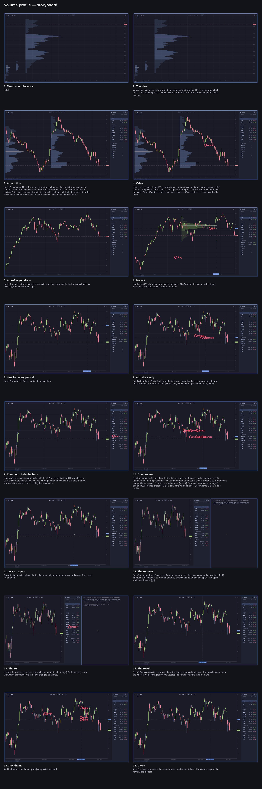

## Brief

**Pitch.** A volume profile shows where a market actually traded, price
by price. It is the basic instrument of auction market theory, and in
Omacharts it is a drawing, a study, and composites you can build by hand
or hand to an agent.

**For.** Traders who have heard of volume profile, value area and point
of control but never used them, and Omacharts users who haven't turned the
study on yet. No prior auction theory assumed.

**Payoff.** Straight after the cover: SPY on four-hour bars with the bars
hidden, a monthly profile under every month, and in a few quick seconds
the months fold together into four wide composites, each with one point
of control and one value area. No terminal yet; that is saved for the
end. Then the first line says the idea in plain words: where the volume
sits tells you what the market agreed was fair. That first word lands
about ten seconds in, cover included, by design: the fold plays in
silence so it can be seen.

**Beats.** Each section opens with a sentence or two over its chart, with
nothing moving, saying what it is about. The first one also carries the
idea that ties the video together.
1. **The idea: an auction.** One SPY session profile, held still. Kept
   short and plain: the volume profile comes from auction market theory;
   the market is an auction, and price moves up and down to find the
   other side of the trade. In balance it trades inside value and builds
   the profile; out of balance it leaves to find new value. One zoom,
   held while the value area (the band holding about seventy percent of
   the volume) and the point of control (the busiest price) are named.
   When price leaves value, either it's rejected and comes back, or it's
   accepted and new value builds there.
2. **The drawing.** The quickest profile: exactly the bars you choose.
   On QQQ, Alt and V, drag across a rally from its low to its high, and
   the profile of just those bars appears. Pull a corner grip to stretch
   it a few bars and it's worked out again.
3. **The study.** On a fresh SPY four-hour chart, add Volume Profile
   (Ctrl and Shift and I). One profile per session, under the candles.
   Right-click a profile and step Reset every to Week, then Month. Zoom
   out to a year and a half of months and hide the bars (Ctrl and Alt and
   Shift and H): with only the profiles left, where price found balance
   is plain to see.
4. **Composites.** On that same view: neighbouring months that share
   their value are really one balance. Right-click, Merge with previous
   profile, three times: December 2025 to March 2026 becomes one profile,
   one point of control, one value area.
5. **Ask an agent.** Doing that across the whole chart is a judgement
   applied many times, which is what an agent is for. A terminal opens
   on the right, the agent already waiting at its prompt; the request is
   typed in plain words: merge neighbouring profiles with value areas
   overlapping at least 50%. The
   agent reads the profiles (`omacharts chart profile list --on-screen
   --json`) and merges right to left (`omacharts chart profile merge --at
   …`); each merge lands on the chart as it runs, the first one with a
   zoom on the chart. The terminal closes, the bars come back.
6. **Any theme.** Preferences › Theme, two themes, one of them light; the
   candles, profiles and composites recolour live. Mostly music.
7. **Close.** One line on what the profile gives you, and where to read
   more: the Volume page of the manual.

**What the source changes.**
- Order: the drawing now comes straight after the theory, so the study,
  zooming out, hiding the bars, composites by hand and the agent all
  happen on one SPY chart, in the sequence the author asked for.
- The drawing key, Alt and V, is missing from the `?` shortcuts list; that
  is being fixed separately, and the close points at the manual, not `?`.
- Drawings show on every chart of their symbol, and composites belong to
  their chart, symbol and period. So the teaser has a chartbook of its own
  (SPY, the same view, folded by the CLI off the timeline's main thread),
  the theory its own SPY five-minute chart, the drawing QQQ, and the study,
  composites and agent share one SPY four-hour chart. The agent starts on
  the composite made by hand and does the rest.
- Composites by hand happen on screen through the profile's own menu, the
  way a person does it. The agent section is the one place the terminal
  is the subject, as asked.
- The terminal is real, tiled to the right of the app at about 38% of the
  width, and runs `vp-agent`, which plays an agent's turn with the real
  `omacharts` commands against the studio window, so the data is the same
  every render.
- The craft guide allows only cuts and short crossfades. The sweep as the
  terminal opens and closes is an exception for the agent section only, because the author asked for them.
  Everything else cuts.
- The composite ranges come from the author's own run on SPY four-hour
  with monthly profiles: September to November 2025, December 2025 to
  March 2026, May to July 2026 and August to October 2026. The narration
  quotes no prices, percentages or counts the app shows; the storyboard
  reads them off the studio.
- The agent itself is shown, not named, unless the author wants it named.
- Length: the author is fine with two minutes or more, so each section
  takes the time it needs: about four minutes all told (240s), most of it
  narration at a relaxed pace, with real holds where the app is working.

## Setup

Four chartbooks, one per stretch of the video, in strip order: SPY (the
teaser: four-hour, monthly profiles, eighteen months, bars hidden), Auction
(SPY fifteen-minute, regular session, session profiles), QQQ (daily, six
months, nothing on it) and Study (SPY four-hour, three months, nothing on
it yet). New charts open on no chart template, so nothing leaks into the
Default template. The sidebar is hidden for the whole video: it is each
chartbook's own, and a new one opens with it shown, so every chartbook is
visited once at the end and Ctrl and B hides it there. A span set with
`chart range` picks its own resolution unless one is given, and a chartbook
switched to comes back at the same zoom but on its latest bar, so the
teaser's eighteen months are set last, on SPY, and the Auction chart is on
fifteen-minute bars, where a week of sessions survives the switch.

    cli template default none
    cli chartbook rename "Chartbook 1" SPY
    cli chart set --symbol SPY --template none --bars off
    cli chart indicator add volume_profile --anchor month
    cli chartbook create Auction --symbol SPY --switch
    cli chart set --session regular
    cli chart indicator add volume_profile
    cli chart range "oct 28:oct 30" --resolution 15m
    cli chartbook create QQQ --symbol QQQ --switch
    cli chart range 6m --resolution 1D
    cli chartbook create Study --symbol SPY --switch
    cli chart range 3m --resolution 4h
    wait 1.5
    key ctrl+shift+b
    cli chartbook switch QQQ
    wait 1.5
    key ctrl+shift+b
    cli chartbook switch Auction
    wait 1.5
    key ctrl+shift+b
    cli chartbook switch SPY
    wait 1.5
    key ctrl+shift+b
    cli chart range 18m --resolution 4h
    wait 1.0

## Script

### 1. Months into balance

**Picture.** SPY on four-hour bars over the last eighteen months, the bars
hidden, so the chart is only a row of blue monthly profiles, each with its
stronger value area and its point of control. Held still for about two
seconds, long enough to take in the months. Then, right to left, a third of
a second apart, neighbouring months fold together: October 2026 into
September and that into August; July into June and that into May; March
2026 into February, January and December; November 2025 into October and
September. Four wide composites stand among the single months, each with
one point of control and one value area. Held a beat. No voice in this
scene. (The merges are `cli`, as a preview of the agent's result; the
storyboard checks they match what the agent leaves in scene 14.)

**Voice.** {fold}

    fold: wait 1.0; cli chart profile merge --at 2026-10-15; wait 0.3; cli chart profile merge --at 2026-09-15; wait 0.3; cli chart profile merge --at 2026-07-15; wait 0.3; cli chart profile merge --at 2026-06-15; wait 0.3; cli chart profile merge --at 2026-03-16; wait 0.3; cli chart profile merge --at 2026-02-16; wait 0.3; cli chart profile merge --at 2026-01-15; wait 0.3; cli chart profile merge --at 2025-11-14; wait 0.3; cli chart profile merge --at 2025-10-15
    after: 5.0

### 2. The idea

**Picture.** The folded chart from scene 1, held. Nothing moves.

**Voice.** Where the volume sits tells you what the market agreed was
fair. This is a year and a half of SPY, one volume profile a month, with
the months that traded at the same prices folded into one.

    after: 0.6

### 3. An auction

**Picture.** Ctrl and Alt and right arrow: the Auction chartbook, SPY on
fifteen-minute bars over the last week's regular sessions, a session
profile at the start of each, the value area stronger and the point of control a line
across it. Nothing else moves.

**Voice.** {next}A volume profile is the volume traded at each price,
stacked sideways against the bars. It comes from auction market theory,
and the basics are short. The market is an auction. Price moves up and down to find the other
side of each trade. In balance, it trades inside value and builds the
profile; out of balance, it leaves to find new value.

    next: key ctrl+alt+Right
    after: 0.6

### 4. Value

**Picture.** The same chart. On "value area", one zoom of about two times
on Friday's profile, the widest of the week, framing its stronger band and the point
of control line together. Nothing else acts in the scene, so it holds
for the composer's longest, eight seconds, through the value area and
point of control lines and into "When price leaves value", then eases back
to the full chart. The cursor stays off the chart.

**Voice.** Here's one session. {zoom}The value area is the band holding
about seventy percent of the volume. The point of control is the busiest
price. When price leaves value, the market tests the move. Either it's
rejected and price comes back, or it's accepted and new value builds
there.

    zoom: zoom 73% 68% 2.0
    after: 0.8

### 5. A profile you draw

**Picture.** Ctrl and Alt and right arrow: the QQQ chartbook, QQQ daily
over six months, candles only. Nothing else moves.

**Voice.** {next}The quickest way to get a profile is to draw one, over
exactly the bars you choose. A rally, say, from its low to its high.

    next: key ctrl+alt+Right
    after: 0.5

### 6. Draw it

**Picture.** Alt and V, its badge on screen. The cursor presses at the
low of a clean rally in the middle of the chart and drags to its high; on
release, a profile of just those bars appears behind them, as tall as
their range, its value area stronger and its point of control a line. It
is left selected, a grip at each corner. The cursor takes the top-right
grip and pulls it a few bars to the right; the profile widens and is
worked out again.

**Voice.** {tool}Alt and V, {drag}and drag across the move. That's where
its volume traded. {grip}Stretch it a few bars, and it's worked out again.

    tool: key alt+v
    drag: drag 50% 50.5% 78.8% 7.8%
    grip: drag 78.8% 7.8% 83% 7.8%; wait 0.6; key Escape; move 40% 99.3%
    after: 1.0

### 7. One for every period

**Picture.** Ctrl and Alt and right arrow: the Study chartbook, SPY on
four-hour bars over the last three months, candles only, the header naming
SPY and 4h. Nothing else moves.

**Voice.** {next}For a profile of every period, there's a study.

    next: key ctrl+alt+Right
    after: 0.5

### 8. Add the study

**Picture.** Ctrl and Shift and I opens **Add an indicator**; "profile"
is typed and Enter picks Volume Profile, whose settings open; Ctrl and
Enter adds it. A narrow profile sits at the start of every session, under
the candles. The cursor right-clicks a profile near the middle of the
chart and its menu opens, the **Reset every** buttons along the top with
Session ringed, the period in use; a click on **Week** redraws one profile
a week. Another right-click on a weekly profile, a click on **Month**:
four monthly profiles, wide and easy to read. (A session profile on
four-hour bars is about two bars wide, and the menu only opens with the
pointer on a profile's rows, so the storyboard pins both right-clicks on
rows.)

**Voice.** {add}Add Volume Profile {pick}from the indicators, {done}and
every session gets its own. For a wider view, {menu1}reset it {week}every
week, {menu2}or {month}every month.

    add:   key ctrl+shift+i
    pick:  type profile; key Return
    done:  key ctrl+Return; wait 0.6; key Escape
    menu1: rclick 53.1% 22.9%
    week:  click 58.9% 24.5%
    menu2: rclick 53.4% 28.6%
    month: click 62.8% 30.3%; wait 0.6; key Escape
    after: 1.0

### 9. Zoom out, hide the bars

**Picture.** The cursor rests near the right of the plot and the wheel
zooms time out about it: the months shrink until about a year and a half
is on screen, May 2025 to now, a monthly profile under every month. Ctrl
and Alt and Shift and H, its badge on screen: the candles disappear and
only the profiles are left. Runs of months stacked at the same prices
stand out from the ones that moved. Held, the cursor off the chart.

**Voice.** Now {out}zoom out to a year and a half. {hide}Control, Alt,
Shift and H hides the bars. With only the profiles left, you can see where
price found balance at a glance: months stacked at the same prices,
building the same value.

    out:  scroll 88% 50% 11
    hide: key ctrl+alt+shift+h; wait 0.4; move 40% 99.3%
    after: 1.2

### 10. Composites

**Picture.** The same view, bars hidden. Nothing moves for the first two
sentences. Then the cursor right-clicks January 2026's profile and its
menu opens; a click on **Merge with previous profile** folds it into
December: one wider profile, one point of control, one value area over
both. A right-click on February, Merge with previous profile, and it joins;
the same on March. December to March is one composite, its value area
across all four months. Held, the cursor off the chart.

**Voice.** Neighbouring months that share their value are really one
balance, and a composite treats them as one. {menu1}December and January
traded at the same prices, {merge1}so merge them: one profile, one point of
control, one value area. {menu2}February overlaps too, {merge2}and
{menu3}so does {merge3}March. That's the whole balance, December to March,
in one profile.

    menu1:  rclick 41.8% 44.3%
    merge1: click 47.3% 49.1%
    menu2:  rclick 47% 46%
    merge2: click 52.5% 50.8%
    menu3:  rclick 52% 51.9%
    merge3: click 57.5% 56.8%; wait 0.6; key Escape; move 50% 98%
    after: 1.2

### 11. Ask an agent

**Picture.** The same view, the December to March composite among the
single months. Nothing moves.

**Voice.** Doing that across the whole chart is the same judgement, made
again and again. That's work for an agent.

    after: 0.5

### 12. The request

**Picture.** A terminal opens on the right, taking about 38% of the
width, themed like the app, the composer covering the snap with a light
sweep and labelling the two panes; the chart reflows into the rest. The
terminal opens with the agent already running, at its bare `❯` prompt,
nothing typed to start it. (The chart is narrower now: the storyboard
checks how many months are still on screen against scene 1.) The request
is typed at the prompt at human speed: "Merge neighbouring profiles with
value areas overlapping at least 50%". Enter sends it.

**Voice.** {open}An agent drives Omacharts from the terminal, with the
same commands you'd type. {ask}The rule is at least half, so a month that
only brushes the next one stays apart. The agent works out the rest. {go}

    open:  terminal open vp-agent --pace 0.8; move 140% 97%
    ask:   type Merge neighbouring profiles that share a balance: value areas overlapping at least 50%
    go:    key Return
    after: 1.8

### 13. The run

**Picture.** The agent's one sentence of plan, then the real `omacharts
chart profile list --on-screen --json` and how many profiles it found.
Then it walks them right to left, a line per pair: a merge prints its
overlap and the real `omacharts chart profile merge --at …`, and the
profile on the left folds into its neighbour as it lands; a pair that
doesn't overlap enough says "kept apart" in grey, and so does April
2026 against the December to March composite: they overlap, but April's
value area is more than twice as wide, a month that trended through that
value rather than shared it. On "Each", timed to the
first merge (October 2026 into September), one zoom of about 1.8 times on
those two profiles at the right of the chart pane, held until it eases
back for the rest, which run at their own pace. It ends on its summary
line, how many merges and how many profiles there are now. The run takes
about seventeen seconds at this pace, six merges and nine pairs kept
apart, leaving the four composites of scene 1; the storyboard measures it and sets `after:` so the summary line
is on screen and read before the scene ends.

**Voice.** It reads the profiles on screen and walks them right to left.
{merge}Each merge is a real Omacharts command, and the chart changes as it
lands. It keeps April apart: that month trended through the range rather
than sat in it.

    merge: zoom 23% 18% 1.8
    after: 9.5

### 14. The result

**Picture.** The terminal closes, the same light sweep covering it, and
the chart widens back to the full frame: the same eighteen months, bars hidden, now four
wide composites among the single months. Held through the first two
sentences. Then Ctrl and Alt and Shift and H, its badge on screen, and the
candles come back over the profiles. Held, the cursor off the chart.

**Voice.** {close}Each composite is a range where the market accepted one
value. The gaps between them are where it went looking for the next.
{bars}The same keys bring the bars back.

    close: terminal close; focus app; move 40% 99.3%
    bars:  key ctrl+alt+shift+h
    after: 1.5

### 15. Any theme

**Picture.** The chart from scene 14, held while the section is
introduced. Then Ctrl and comma opens Preferences over the middle of the
window. A click on **Theme** in its sidebar and a click on the **Theme**
row's drop-down: Omacharts' own themes, then every Omarchy theme installed
on the desktop, the same list the author sees. The wheel runs the list
down to its end, and a click on **Rose Pine**: the window, the candles,
the profiles and the composites turn to it at once, a warm light ground.
Escape closes Preferences and the full chart holds in Rose Pine for about
two seconds. Ctrl and comma again, straight back on Theme, the drop-down,
**Everforest**: everything goes dark green-grey, the profiles recoloured
to match. Escape, and the full chart holds in Everforest, the music up in
the gap. (The studio copies the author's installed Omarchy themes, so the
list matches theirs.)

**Voice.** And it all follows the theme, {prefs}any of your Omarchy
themes, composites included.

    prefs: key ctrl+comma; wait 0.8; click 27.6% 21.4%; wait 0.6; click 69.5% 16.7%; wait 0.8; scroll 69.5% 40% 10; wait 0.6; scroll 69.5% 40% 10; wait 0.8; click 68.4% 40.9%; wait 0.6; key Escape; move 40% 99.3%; wait 2.5; key ctrl+comma; wait 0.8; click 69.5% 16.7%; wait 0.6; click 68.4% 50.2%; wait 0.6; key Escape; move 40% 99.3%
    after: 17.5

### 16. Close

**Picture.** SPY four-hour in Everforest, bars and composites showing, held.
The cursor rests off the chart.

**Voice.** A profile shows you where the market agreed, and where it
didn't. The Volume page of the manual has the rest.

    after: 2.5

## Pronunciation

- SPY: S P Y
- QQQ: triple Q
- Omacharts: Oma-charts

## Storyboard

